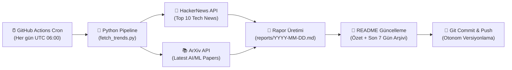

# 📡 AI & Tech Daily Radar

<p align="center">
  
  
  
  
  
</p>

> **AI & Tech Daily Radar**, her gün GitHub Actions üzerinde otonom olarak çalışan; HackerNews üzerindeki en sıcak teknoloji gelişmelerini ve ArXiv üzerindeki en yeni Yapay Zeka / Makine Öğrenimi (AI & ML) araştırma makalelerini toplayıp derleyen modern bir veri hattıdır (data pipeline).

---

<!-- LATEST_REPORT_START -->
### ⚡ Son Güncelleme: `2026-10-28`

> 📊 **Bugünün Özeti:** 10 HackerNews teknoloji trendi ve 5 ArXiv AI/ML akademik makalesi tarandı.  
> 📑 **Tam Rapor:** [Günün Raporunu Görüntüle (`reports/2026-10-28.md`)](reports/2026-10-28.md)

#### 🔥 HackerNews Öne Çıkanlar
| Başlık | Puan | Yorum | HN Linki |
|--------|:----:|:-----:|:--------:|
| [Ghostty 1.4](https://ghostty.org/docs/install/release-notes/1-4-0) | ⭐ 1083 | 💬 343 | [Tartışma](https://news.ycombinator.com/item?id=50261998) |
| [US Government is hiding a secret court ruling about how it spies on Americans](https://www.wired.com/story/the-us-government-is-hiding-a-secret-court-ruling-about-how-it-spies-on-americans/) | ⭐ 966 | 💬 367 | [Tartışma](https://news.ycombinator.com/item?id=50259604) |
| [Genie 4](https://deepmind.google/blog/genie-4-a-new-generation-of-world-simulation/) | ⭐ 920 | 💬 532 | [Tartışma](https://news.ycombinator.com/item?id=50261319) |
| [Python's experimental JIT to be removed](https://lwn.net/SubscriberLink/1102102/0c00e4d550f25f8c/) | ⭐ 527 | 💬 283 | [Tartışma](https://news.ycombinator.com/item?id=50257419) |
| [Survival LLM: AI assistant and emergency library that runs on your own computer](https://www.brangus.io/survival-llm) | ⭐ 384 | 💬 148 | [Tartışma](https://news.ycombinator.com/item?id=50264853) |

#### 🤖 ArXiv AI/ML Öne Çıkan Araştırmalar
- 📄 **[Honeycomb-Surfels: Compact Hexagonal Primitives for Efficient Scene Rendering and Reconstruction](http://arxiv.org/abs/2610.37668v1)**
  *Novel view synthesis and 3D reconstruction have advanced rapidly with radiance fields and splatting, yet their memory and computational demands limit their use in resource-constrained settings. We int...*

- 📄 **[ThinkWorld: World Imagination Reinforces Chain-of-Dynamics Reasoning](http://arxiv.org/abs/2610.37666v1)**
  *Vision-Language-Action (VLA) models have made substantial progress in robotic manipulation, but their generalization remains constrained by the diversity and coverage of action-labeled robot demonstra...*

- 📄 **[When Should We Intervene at Test Time?](http://arxiv.org/abs/2610.37658v1)**
  *Test-time adaptation helps a deployed model respond to changing inputs, but the same intervention can rescue one batch and damage the next. Updating normalization statistics, for example, can improve...*

#### 🗄️ Son 7 Günün Rapor Arşivi
- [📅 2026-10-28 Raporu](reports/2026-10-28.md)
- [📅 2026-10-27 Raporu](reports/2026-10-27.md)
- [📅 2026-10-26 Raporu](reports/2026-10-26.md)
- [📅 2026-10-25 Raporu](reports/2026-10-25.md)
- [📅 2026-10-24 Raporu](reports/2026-10-24.md)
- [📅 2026-10-23 Raporu](reports/2026-10-23.md)
- [📅 2026-10-22 Raporu](reports/2026-10-22.md)
<!-- LATEST_REPORT_END -->

---

## 🏗️ Mimari ve Nasıl Çalışır?

Bu sistem, harici bir sunucu veya veritabanı ihtiyacı olmadan tamamen **serverless** ve **Git-as-a-Database** yaklaşımıyla çalışacak şekilde tasarlanmıştır:



### ⚙️ Çalışma Aşamaları (ETL)

1. **Extract (Çıkarma):**
   - **HackerNews Algolia API:** Günün en popüler 10 teknoloji trendini (başlık, puan, yorum sayısı, URL) çeker.
   - **ArXiv API:** Bilgisayar Bilimleri / Yapay Zeka (`cs.AI`) ve Makine Öğrenimi (`cs.LG`) kategorilerinde yayımlanan en güncel 5 akademik makaleyi (`ElementTree` XML ayrıştırıcı ile) çeker.

2. **Transform (Dönüştürme):**
   - Alınan ham veriler standart bir Markdown formatına dönüştürülür.
   - Makale özetleri optimize edilir, tablolar ve bağlantılar biçimlendirilir.
   - Son 7 günün arşiv linkleri otomatik tespit edilir.

3. **Load (Yükleme & Dağıtım):**
   - Günün tarihine özel `reports/YYYY-MM-DD.md` dosyası oluşturulur.
   - Ana dizindeki `README.md` dosyasındaki belirlenmiş işaretçiler arasına güncel özet ve arşiv tablosu işlenir.
   - Değişiklikler GitHub Actions botu tarafından depoya geri `commit` ve `push` edilir.

---

## 🚀 Yerel Kurulum ve Çalıştırma

Projeyi yerel makinenizde test etmek isterseniz:

```bash
# 1. Projeyi klonlayın
git clone https://github.com/themuhammedguler/ai-tech-radar.git
cd ai-tech-radar

# 2. Bağımlılıkları yükleyin
pip install -r requirements.txt

# 3. Veri hattını çalıştırın
python src/fetch_trends.py
```

Rapor oluşturulduktan sonra `reports/` dizinini ve `README.md` dosyasını inceleyebilirsiniz.

---

## 📜 Lisans

Bu proje [MIT](LICENSE) lisansı ile lisanslanmıştır.
