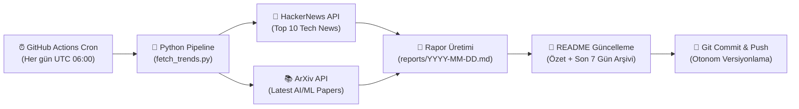

# 📡 AI & Tech Daily Radar

<p align="center">
  
  
  
  
  
</p>

> **AI & Tech Daily Radar**, her gün GitHub Actions üzerinde otonom olarak çalışan; HackerNews üzerindeki en sıcak teknoloji gelişmelerini ve ArXiv üzerindeki en yeni Yapay Zeka / Makine Öğrenimi (AI & ML) araştırma makalelerini toplayıp derleyen modern bir veri hattıdır (data pipeline).

---

<!-- LATEST_REPORT_START -->
### ⚡ Son Güncelleme: `2026-10-19`

> 📊 **Bugünün Özeti:** 10 HackerNews teknoloji trendi ve 5 ArXiv AI/ML akademik makalesi tarandı.  
> 📑 **Tam Rapor:** [Günün Raporunu Görüntüle (`reports/2026-10-19.md`)](reports/2026-10-19.md)

#### 🔥 HackerNews Öne Çıkanlar
| Başlık | Puan | Yorum | HN Linki |
|--------|:----:|:-----:|:--------:|
| [Someone behind the software](https://karrisaarinen.com/posts/someone-behind-the-software/) | ⭐ 468 | 💬 169 | [Tartışma](https://news.ycombinator.com/item?id=50142573) |
| [Hybrid Reasoning Agents: LLM agents that think in latent space, act through text](https://arxiv.org/abs/2610.18861) | ⭐ 428 | 💬 213 | [Tartışma](https://news.ycombinator.com/item?id=50145337) |
| [RepRapMicron](https://github.com/VikOlliver/RepRapMicron/wiki) | ⭐ 404 | 💬 64 | [Tartışma](https://news.ycombinator.com/item?id=50141076) |
| [There's never been a better time to go into math (by: 3blue1brown) [video]](https://www.youtube.com/watch?v=LKrwhjOI8Nc) | ⭐ 402 | 💬 503 | [Tartışma](https://news.ycombinator.com/item?id=50136150) |
| [Linux 7.3 Released](https://lwn.net/Articles/1101143/) | ⭐ 287 | 💬 127 | [Tartışma](https://news.ycombinator.com/item?id=50149392) |

#### 🤖 ArXiv AI/ML Öne Çıkan Araştırmalar
- 📄 **[Rethinking the design space of Vanilla Pixel Diffusion Transformers](http://arxiv.org/abs/2610.23854v1)**
  *Pixel-space diffusion models have recently re-emerged as a compelling alternative to latent diffusion, avoiding the lossy latent bottleneck and separately trained autoencoder. JiT shows that a vanilla...*

- 📄 **[Behavioral Couplings: From Formation to Behavioral Emergence in Language Models](http://arxiv.org/abs/2610.23847v1)**
  *Fine-tuning large language models (LLMs) can induce behaviors beyond those explicitly targeted. For example, training a model to respond more warmly can make it more sycophantic, and training it to wr...*

- 📄 **[AI-Driven Reproducibility and Analytical Robustness in Scientific Discovery](http://arxiv.org/abs/2610.23845v1)**
  *Reproducible and analytically robust research findings are essential to scientific progress, but evaluating these properties typically requires costly manual effort. We investigate whether LLM agents...*

#### 🗄️ Son 7 Günün Rapor Arşivi
- [📅 2026-10-19 Raporu](reports/2026-10-19.md)
- [📅 2026-10-18 Raporu](reports/2026-10-18.md)
- [📅 2026-10-17 Raporu](reports/2026-10-17.md)
- [📅 2026-10-16 Raporu](reports/2026-10-16.md)
- [📅 2026-10-15 Raporu](reports/2026-10-15.md)
- [📅 2026-10-14 Raporu](reports/2026-10-14.md)
- [📅 2026-10-13 Raporu](reports/2026-10-13.md)
<!-- LATEST_REPORT_END -->

---

## 🏗️ Mimari ve Nasıl Çalışır?

Bu sistem, harici bir sunucu veya veritabanı ihtiyacı olmadan tamamen **serverless** ve **Git-as-a-Database** yaklaşımıyla çalışacak şekilde tasarlanmıştır:



### ⚙️ Çalışma Aşamaları (ETL)

1. **Extract (Çıkarma):**
   - **HackerNews Algolia API:** Günün en popüler 10 teknoloji trendini (başlık, puan, yorum sayısı, URL) çeker.
   - **ArXiv API:** Bilgisayar Bilimleri / Yapay Zeka (`cs.AI`) ve Makine Öğrenimi (`cs.LG`) kategorilerinde yayımlanan en güncel 5 akademik makaleyi (`ElementTree` XML ayrıştırıcı ile) çeker.

2. **Transform (Dönüştürme):**
   - Alınan ham veriler standart bir Markdown formatına dönüştürülür.
   - Makale özetleri optimize edilir, tablolar ve bağlantılar biçimlendirilir.
   - Son 7 günün arşiv linkleri otomatik tespit edilir.

3. **Load (Yükleme & Dağıtım):**
   - Günün tarihine özel `reports/YYYY-MM-DD.md` dosyası oluşturulur.
   - Ana dizindeki `README.md` dosyasındaki belirlenmiş işaretçiler arasına güncel özet ve arşiv tablosu işlenir.
   - Değişiklikler GitHub Actions botu tarafından depoya geri `commit` ve `push` edilir.

---

## 🚀 Yerel Kurulum ve Çalıştırma

Projeyi yerel makinenizde test etmek isterseniz:

```bash
# 1. Projeyi klonlayın
git clone https://github.com/themuhammedguler/ai-tech-radar.git
cd ai-tech-radar

# 2. Bağımlılıkları yükleyin
pip install -r requirements.txt

# 3. Veri hattını çalıştırın
python src/fetch_trends.py
```

Rapor oluşturulduktan sonra `reports/` dizinini ve `README.md` dosyasını inceleyebilirsiniz.

---

## 📜 Lisans

Bu proje [MIT](LICENSE) lisansı ile lisanslanmıştır.
