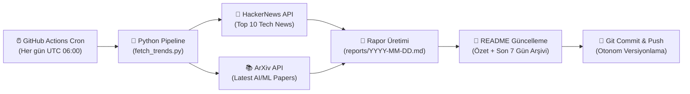

# 📡 AI & Tech Daily Radar

<p align="center">
  
  
  
  
  
</p>

> **AI & Tech Daily Radar**, her gün GitHub Actions üzerinde otonom olarak çalışan; HackerNews üzerindeki en sıcak teknoloji gelişmelerini ve ArXiv üzerindeki en yeni Yapay Zeka / Makine Öğrenimi (AI & ML) araştırma makalelerini toplayıp derleyen modern bir veri hattıdır (data pipeline).

---

<!-- LATEST_REPORT_START -->
### ⚡ Son Güncelleme: `2026-10-22`

> 📊 **Bugünün Özeti:** 10 HackerNews teknoloji trendi ve 5 ArXiv AI/ML akademik makalesi tarandı.  
> 📑 **Tam Rapor:** [Günün Raporunu Görüntüle (`reports/2026-10-22.md`)](reports/2026-10-22.md)

#### 🔥 HackerNews Öne Çıkanlar
| Başlık | Puan | Yorum | HN Linki |
|--------|:----:|:-----:|:--------:|
| [Today's PHP security release, and how we're strengthening security](https://thephp.foundation/blog/2026/10/21/todays-php-security-release-and-how-were-strengthening-php-security/) | ⭐ 745 | 💬 369 | [Tartışma](https://news.ycombinator.com/item?id=50182987) |
| [Meta ordered to pay $25B penalty in New Mexico Cambridge Analytica case](https://www.cnbc.com/2026/10/21/meta-new-mexico-cambridge-analytica-penalty.html) | ⭐ 579 | 💬 333 | [Tartışma](https://news.ycombinator.com/item?id=50184820) |
| [There isn't an easy exploit for this PHP vulnerability](https://eliastaylor.com/noexploit/) | ⭐ 541 | 💬 328 | [Tartışma](https://news.ycombinator.com/item?id=50188948) |
| [Compromised LiteLLM 1.107.0 on PyPI Installs a Credential Stealer and Backdoor](https://safedep.io/litellm-pypi-compromise-credential-stealer-backdoor/) | ⭐ 532 | 💬 172 | [Tartışma](https://news.ycombinator.com/item?id=50181114) |
| [mitmproxy adds --emudhra option](https://github.com/mitmproxy/mitmproxy/commit/169234499088fc2c414644a67efaed3d64ae2e3b) | ⭐ 499 | 💬 117 | [Tartışma](https://news.ycombinator.com/item?id=50189232) |

#### 🤖 ArXiv AI/ML Öne Çıkan Araştırmalar
- 📄 **[LongZero: Enhancing Long-Context Reasoning in LLMs from Zero Data](http://arxiv.org/abs/2610.30132v1)**
  *Reinforcement learning (RL) is an effective way to strengthen the long-context reasoning of large language models (LLMs), but it needs training data that are long, diverse, challenging, and verifiable...*

- 📄 **[Think Harder Where It Matters: Item-Level Adaptive Recursion for Sequential Recommendation](http://arxiv.org/abs/2610.30128v1)**
  *Existing sequential recommenders usually allocate a fixed computational budget to every item in a user's interaction history, regardless of the item's contribution to the final prediction. We challeng...*

- 📄 **[PhysiCalWorld: In-Context Physics Calibration for World Models](http://arxiv.org/abs/2610.30125v1)**
  *Existing world models typically perceive a scene through current visual frame or a narrow history window. However, these observations may not reveal the physics properties that determine transition dy...*

#### 🗄️ Son 7 Günün Rapor Arşivi
- [📅 2026-10-22 Raporu](reports/2026-10-22.md)
- [📅 2026-10-21 Raporu](reports/2026-10-21.md)
- [📅 2026-10-20 Raporu](reports/2026-10-20.md)
- [📅 2026-10-19 Raporu](reports/2026-10-19.md)
- [📅 2026-10-18 Raporu](reports/2026-10-18.md)
- [📅 2026-10-17 Raporu](reports/2026-10-17.md)
- [📅 2026-10-16 Raporu](reports/2026-10-16.md)
<!-- LATEST_REPORT_END -->

---

## 🏗️ Mimari ve Nasıl Çalışır?

Bu sistem, harici bir sunucu veya veritabanı ihtiyacı olmadan tamamen **serverless** ve **Git-as-a-Database** yaklaşımıyla çalışacak şekilde tasarlanmıştır:



### ⚙️ Çalışma Aşamaları (ETL)

1. **Extract (Çıkarma):**
   - **HackerNews Algolia API:** Günün en popüler 10 teknoloji trendini (başlık, puan, yorum sayısı, URL) çeker.
   - **ArXiv API:** Bilgisayar Bilimleri / Yapay Zeka (`cs.AI`) ve Makine Öğrenimi (`cs.LG`) kategorilerinde yayımlanan en güncel 5 akademik makaleyi (`ElementTree` XML ayrıştırıcı ile) çeker.

2. **Transform (Dönüştürme):**
   - Alınan ham veriler standart bir Markdown formatına dönüştürülür.
   - Makale özetleri optimize edilir, tablolar ve bağlantılar biçimlendirilir.
   - Son 7 günün arşiv linkleri otomatik tespit edilir.

3. **Load (Yükleme & Dağıtım):**
   - Günün tarihine özel `reports/YYYY-MM-DD.md` dosyası oluşturulur.
   - Ana dizindeki `README.md` dosyasındaki belirlenmiş işaretçiler arasına güncel özet ve arşiv tablosu işlenir.
   - Değişiklikler GitHub Actions botu tarafından depoya geri `commit` ve `push` edilir.

---

## 🚀 Yerel Kurulum ve Çalıştırma

Projeyi yerel makinenizde test etmek isterseniz:

```bash
# 1. Projeyi klonlayın
git clone https://github.com/themuhammedguler/ai-tech-radar.git
cd ai-tech-radar

# 2. Bağımlılıkları yükleyin
pip install -r requirements.txt

# 3. Veri hattını çalıştırın
python src/fetch_trends.py
```

Rapor oluşturulduktan sonra `reports/` dizinini ve `README.md` dosyasını inceleyebilirsiniz.

---

## 📜 Lisans

Bu proje [MIT](LICENSE) lisansı ile lisanslanmıştır.
