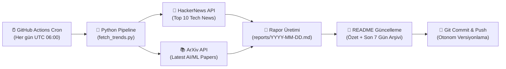

# 📡 AI & Tech Daily Radar

<p align="center">
  
  
  
  
  
</p>

> **AI & Tech Daily Radar**, her gün GitHub Actions üzerinde otonom olarak çalışan; HackerNews üzerindeki en sıcak teknoloji gelişmelerini ve ArXiv üzerindeki en yeni Yapay Zeka / Makine Öğrenimi (AI & ML) araştırma makalelerini toplayıp derleyen modern bir veri hattıdır (data pipeline).

---

<!-- LATEST_REPORT_START -->
### ⚡ Son Güncelleme: `2026-10-16`

> 📊 **Bugünün Özeti:** 10 HackerNews teknoloji trendi ve 5 ArXiv AI/ML akademik makalesi tarandı.  
> 📑 **Tam Rapor:** [Günün Raporunu Görüntüle (`reports/2026-10-16.md`)](reports/2026-10-16.md)

#### 🔥 HackerNews Öne Çıkanlar
| Başlık | Puan | Yorum | HN Linki |
|--------|:----:|:-----:|:--------:|
| [Muse Spark Open](https://research.meta.ai/blog/muse-spark-open) | ⭐ 823 | 💬 412 | [Tartışma](https://news.ycombinator.com/item?id=50107379) |
| [Neural networks are clean](https://already-clean.goodfire.com/) | ⭐ 699 | 💬 262 | [Tartışma](https://news.ycombinator.com/item?id=50105647) |
| [Wayland desktop for Linux with skeuomorphic design](https://github.com/fyzugx/DEsk) | ⭐ 616 | 💬 241 | [Tartışma](https://news.ycombinator.com/item?id=50103338) |
| [What I self-host](https://viceconsole.fyi/blog/2026/10/10/what-i-self-host/) | ⭐ 498 | 💬 313 | [Tartışma](https://news.ycombinator.com/item?id=50109715) |
| [Jev meets the Trolley Problem](https://zachlandes.com/trolley-problem/) | ⭐ 471 | 💬 201 | [Tartışma](https://news.ycombinator.com/item?id=50106023) |

#### 🤖 ArXiv AI/ML Öne Çıkan Araştırmalar
- 📄 **[LIBERO-PeRM: Benchmarking Personalized Robotic Manipulation](http://arxiv.org/abs/2610.22372v1)**
  *Personalization is essential for general-purpose robots to transition into household environments and achieve true practicality. While general robotic manipulation has been extensively studied, person...*

- 📄 **[Discovering state-of-the-art quantum circuits with large language models](http://arxiv.org/abs/2610.22367v1)**
  *Significant efforts are currently being directed toward the implementation of large-scale quantum information processors, but realizing useful quantum advantage also requires the development of effici...*

- 📄 **[T2-z: Test-Time Optimization of Environment Latents for Robotic World Models](http://arxiv.org/abs/2610.22364v1)**
  *Predicting how the world responds to an action requires more than what can be seen: robots must account for environmental factors that are neither directly observable nor explicitly specified, from ph...*

#### 🗄️ Son 7 Günün Rapor Arşivi
- [📅 2026-10-16 Raporu](reports/2026-10-16.md)
- [📅 2026-10-15 Raporu](reports/2026-10-15.md)
- [📅 2026-10-14 Raporu](reports/2026-10-14.md)
- [📅 2026-10-13 Raporu](reports/2026-10-13.md)
- [📅 2026-10-12 Raporu](reports/2026-10-12.md)
- [📅 2026-10-11 Raporu](reports/2026-10-11.md)
- [📅 2026-10-10 Raporu](reports/2026-10-10.md)
<!-- LATEST_REPORT_END -->

---

## 🏗️ Mimari ve Nasıl Çalışır?

Bu sistem, harici bir sunucu veya veritabanı ihtiyacı olmadan tamamen **serverless** ve **Git-as-a-Database** yaklaşımıyla çalışacak şekilde tasarlanmıştır:



### ⚙️ Çalışma Aşamaları (ETL)

1. **Extract (Çıkarma):**
   - **HackerNews Algolia API:** Günün en popüler 10 teknoloji trendini (başlık, puan, yorum sayısı, URL) çeker.
   - **ArXiv API:** Bilgisayar Bilimleri / Yapay Zeka (`cs.AI`) ve Makine Öğrenimi (`cs.LG`) kategorilerinde yayımlanan en güncel 5 akademik makaleyi (`ElementTree` XML ayrıştırıcı ile) çeker.

2. **Transform (Dönüştürme):**
   - Alınan ham veriler standart bir Markdown formatına dönüştürülür.
   - Makale özetleri optimize edilir, tablolar ve bağlantılar biçimlendirilir.
   - Son 7 günün arşiv linkleri otomatik tespit edilir.

3. **Load (Yükleme & Dağıtım):**
   - Günün tarihine özel `reports/YYYY-MM-DD.md` dosyası oluşturulur.
   - Ana dizindeki `README.md` dosyasındaki belirlenmiş işaretçiler arasına güncel özet ve arşiv tablosu işlenir.
   - Değişiklikler GitHub Actions botu tarafından depoya geri `commit` ve `push` edilir.

---

## 🚀 Yerel Kurulum ve Çalıştırma

Projeyi yerel makinenizde test etmek isterseniz:

```bash
# 1. Projeyi klonlayın
git clone https://github.com/themuhammedguler/ai-tech-radar.git
cd ai-tech-radar

# 2. Bağımlılıkları yükleyin
pip install -r requirements.txt

# 3. Veri hattını çalıştırın
python src/fetch_trends.py
```

Rapor oluşturulduktan sonra `reports/` dizinini ve `README.md` dosyasını inceleyebilirsiniz.

---

## 📜 Lisans

Bu proje [MIT](LICENSE) lisansı ile lisanslanmıştır.
