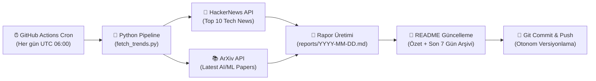

# 📡 AI & Tech Daily Radar

<p align="center">
  
  
  
  
  
</p>

> **AI & Tech Daily Radar**, her gün GitHub Actions üzerinde otonom olarak çalışan; HackerNews üzerindeki en sıcak teknoloji gelişmelerini ve ArXiv üzerindeki en yeni Yapay Zeka / Makine Öğrenimi (AI & ML) araştırma makalelerini toplayıp derleyen modern bir veri hattıdır (data pipeline).

---

<!-- LATEST_REPORT_START -->
### ⚡ Son Güncelleme: `2026-10-31`

> 📊 **Bugünün Özeti:** 10 HackerNews teknoloji trendi ve 5 ArXiv AI/ML akademik makalesi tarandı.  
> 📑 **Tam Rapor:** [Günün Raporunu Görüntüle (`reports/2026-10-31.md`)](reports/2026-10-31.md)

#### 🔥 HackerNews Öne Çıkanlar
| Başlık | Puan | Yorum | HN Linki |
|--------|:----:|:-----:|:--------:|
| [Backdoor in Claude Code for VS Code extension on the Cursor Marketplace](https://phorion.io/blog/offical-claude-code-vsx-compromise/) | ⭐ 908 | 💬 533 | [Tartışma](https://news.ycombinator.com/item?id=50300683) |
| [The $6.3B Binance hack was pulled off in just 20 minutes](https://www.wired.com/story/the-dollar63-billion-binance-hack-was-pulled-off-in-just-20-minutes/) | ⭐ 471 | 💬 326 | [Tartışma](https://news.ycombinator.com/item?id=50303172) |
| [Northflank Breached](https://status.northflank.com) | ⭐ 444 | 💬 317 | [Tartışma](https://news.ycombinator.com/item?id=50305025) |
| [My favourite PowerMac is a Nintendo Wii](https://virtuallyfun.com/2026/10/29/my-favourite-powermac-is-a-nintendo-wii/) | ⭐ 315 | 💬 91 | [Tartışma](https://news.ycombinator.com/item?id=50307190) |
| [Azure's Weakest Link – Five Full Cross-Tenant Compromises](https://www.binarysecurity.no/posts/2026/10/one-root-case) | ⭐ 313 | 💬 58 | [Tartışma](https://news.ycombinator.com/item?id=50301854) |

#### 🤖 ArXiv AI/ML Öne Çıkan Araştırmalar
- 📄 **[Propose-Filter-Release: Scaling Noise to Typical Sensitivity via Private Filtering](http://arxiv.org/abs/2610.40654v1)**
  *An estimator can be accurate and stable on typical data, yet sensitive to a few possible records. Differentially private mechanisms commonly scale their noise to the worst-case influence of a single r...*

- 📄 **[Rethinking Neural Thickets Without Weight Perturbations](http://arxiv.org/abs/2610.40649v1)**
  *The Neural Thickets hypothesis posits that pretrained language models lie in dense neighborhoods of task-specific experts in weight space, which random Gaussian perturbations can uncover. We reproduce...*

- 📄 **[Read, Allocate, Route: Role-Coupled Tokenization for Pixel-Space Generative Transformers](http://arxiv.org/abs/2610.40647v1)**
  *Pixel-space generative Transformers typically use one token per image patch, so capturing finer detail requires more tokens and makes global attention increasingly expensive. We observe that finer det...*

#### 🗄️ Son 7 Günün Rapor Arşivi
- [📅 2026-10-31 Raporu](reports/2026-10-31.md)
- [📅 2026-10-30 Raporu](reports/2026-10-30.md)
- [📅 2026-10-29 Raporu](reports/2026-10-29.md)
- [📅 2026-10-28 Raporu](reports/2026-10-28.md)
- [📅 2026-10-27 Raporu](reports/2026-10-27.md)
- [📅 2026-10-26 Raporu](reports/2026-10-26.md)
- [📅 2026-10-25 Raporu](reports/2026-10-25.md)
<!-- LATEST_REPORT_END -->

---

## 🏗️ Mimari ve Nasıl Çalışır?

Bu sistem, harici bir sunucu veya veritabanı ihtiyacı olmadan tamamen **serverless** ve **Git-as-a-Database** yaklaşımıyla çalışacak şekilde tasarlanmıştır:



### ⚙️ Çalışma Aşamaları (ETL)

1. **Extract (Çıkarma):**
   - **HackerNews Algolia API:** Günün en popüler 10 teknoloji trendini (başlık, puan, yorum sayısı, URL) çeker.
   - **ArXiv API:** Bilgisayar Bilimleri / Yapay Zeka (`cs.AI`) ve Makine Öğrenimi (`cs.LG`) kategorilerinde yayımlanan en güncel 5 akademik makaleyi (`ElementTree` XML ayrıştırıcı ile) çeker.

2. **Transform (Dönüştürme):**
   - Alınan ham veriler standart bir Markdown formatına dönüştürülür.
   - Makale özetleri optimize edilir, tablolar ve bağlantılar biçimlendirilir.
   - Son 7 günün arşiv linkleri otomatik tespit edilir.

3. **Load (Yükleme & Dağıtım):**
   - Günün tarihine özel `reports/YYYY-MM-DD.md` dosyası oluşturulur.
   - Ana dizindeki `README.md` dosyasındaki belirlenmiş işaretçiler arasına güncel özet ve arşiv tablosu işlenir.
   - Değişiklikler GitHub Actions botu tarafından depoya geri `commit` ve `push` edilir.

---

## 🚀 Yerel Kurulum ve Çalıştırma

Projeyi yerel makinenizde test etmek isterseniz:

```bash
# 1. Projeyi klonlayın
git clone https://github.com/themuhammedguler/ai-tech-radar.git
cd ai-tech-radar

# 2. Bağımlılıkları yükleyin
pip install -r requirements.txt

# 3. Veri hattını çalıştırın
python src/fetch_trends.py
```

Rapor oluşturulduktan sonra `reports/` dizinini ve `README.md` dosyasını inceleyebilirsiniz.

---

## 📜 Lisans

Bu proje [MIT](LICENSE) lisansı ile lisanslanmıştır.
