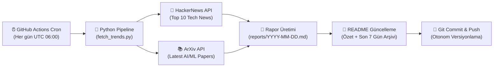

# 📡 AI & Tech Daily Radar

<p align="center">
  
  
  
  
  
</p>

> **AI & Tech Daily Radar**, her gün GitHub Actions üzerinde otonom olarak çalışan; HackerNews üzerindeki en sıcak teknoloji gelişmelerini ve ArXiv üzerindeki en yeni Yapay Zeka / Makine Öğrenimi (AI & ML) araştırma makalelerini toplayıp derleyen modern bir veri hattıdır (data pipeline).

---

<!-- LATEST_REPORT_START -->
### ⚡ Son Güncelleme: `2026-11-03`

> 📊 **Bugünün Özeti:** 10 HackerNews teknoloji trendi ve 5 ArXiv AI/ML akademik makalesi tarandı.  
> 📑 **Tam Rapor:** [Günün Raporunu Görüntüle (`reports/2026-11-03.md`)](reports/2026-11-03.md)

#### 🔥 HackerNews Öne Çıkanlar
| Başlık | Puan | Yorum | HN Linki |
|--------|:----:|:-----:|:--------:|
| [Astra can read and write weights to improve Qwen](https://rikiyat.github.io/blog/weight-space-programming/) | ⭐ 2832 | 💬 856 | [Tartışma](https://news.ycombinator.com/item?id=50341174) |
| [Show HN: Subvocal – Talk to your computer without making noise](https://news.ycombinator.com/item?id=50340088) | ⭐ 747 | 💬 351 | [Tartışma](https://news.ycombinator.com/item?id=50340088) |
| [If you love a website, back it up](https://blog.mistys-internet.website/post/2026/10/29/if-you-love-a-website-back-it-up/) | ⭐ 603 | 💬 141 | [Tartışma](https://news.ycombinator.com/item?id=50336518) |
| [US boy names that became girl names and vice versa](https://namedaisy.com/blog/boy-names-that-became-girl-names) | ⭐ 435 | 💬 414 | [Tartışma](https://news.ycombinator.com/item?id=50339397) |
| [Show HN: Hacker Times, a New York Times-inspired version of Hacker News](https://hackertimes.ca/) | ⭐ 346 | 💬 108 | [Tartışma](https://news.ycombinator.com/item?id=50346981) |

#### 🤖 ArXiv AI/ML Öne Çıkan Araştırmalar
- 📄 **[Pixel-UMI: Learning Environment-Aware Whole-Body Manipulation from Sensorized Human Demonstrations](http://arxiv.org/abs/2611.03647v1)**
  *Sensorized human demonstrations offer scalable data for mobile manipulation, but embodiment differences complicate policy learning. We present Pixel-UMI, a pipeline for learning environment-aware whol...*

- 📄 **[Pixel: A Co-Designed Full-Stack Robot System for Learning General-Purpose Mobile Manipulation](http://arxiv.org/abs/2611.03648v1)**
  *General-purpose mobile manipulation requires a combination of capable robot hardware, scalable demonstration collection, expressive whole-body control, and effective policy learning. Yet these compone...*

- 📄 **[From Natural Language to Exact Cover: A Neuro-Symbolic Approach to Zebra Puzzles](http://arxiv.org/abs/2611.03641v1)**
  *Chain-of-Thought (CoT) generation has substantially improved the performance of Large Language Models (LLMs) on complex reasoning tasks, including code generation, data analysis, and exam-style questi...*

#### 🗄️ Son 7 Günün Rapor Arşivi
- [📅 2026-11-03 Raporu](reports/2026-11-03.md)
- [📅 2026-11-02 Raporu](reports/2026-11-02.md)
- [📅 2026-11-01 Raporu](reports/2026-11-01.md)
- [📅 2026-10-31 Raporu](reports/2026-10-31.md)
- [📅 2026-10-30 Raporu](reports/2026-10-30.md)
- [📅 2026-10-29 Raporu](reports/2026-10-29.md)
- [📅 2026-10-28 Raporu](reports/2026-10-28.md)
<!-- LATEST_REPORT_END -->

---

## 🏗️ Mimari ve Nasıl Çalışır?

Bu sistem, harici bir sunucu veya veritabanı ihtiyacı olmadan tamamen **serverless** ve **Git-as-a-Database** yaklaşımıyla çalışacak şekilde tasarlanmıştır:



### ⚙️ Çalışma Aşamaları (ETL)

1. **Extract (Çıkarma):**
   - **HackerNews Algolia API:** Günün en popüler 10 teknoloji trendini (başlık, puan, yorum sayısı, URL) çeker.
   - **ArXiv API:** Bilgisayar Bilimleri / Yapay Zeka (`cs.AI`) ve Makine Öğrenimi (`cs.LG`) kategorilerinde yayımlanan en güncel 5 akademik makaleyi (`ElementTree` XML ayrıştırıcı ile) çeker.

2. **Transform (Dönüştürme):**
   - Alınan ham veriler standart bir Markdown formatına dönüştürülür.
   - Makale özetleri optimize edilir, tablolar ve bağlantılar biçimlendirilir.
   - Son 7 günün arşiv linkleri otomatik tespit edilir.

3. **Load (Yükleme & Dağıtım):**
   - Günün tarihine özel `reports/YYYY-MM-DD.md` dosyası oluşturulur.
   - Ana dizindeki `README.md` dosyasındaki belirlenmiş işaretçiler arasına güncel özet ve arşiv tablosu işlenir.
   - Değişiklikler GitHub Actions botu tarafından depoya geri `commit` ve `push` edilir.

---

## 🚀 Yerel Kurulum ve Çalıştırma

Projeyi yerel makinenizde test etmek isterseniz:

```bash
# 1. Projeyi klonlayın
git clone https://github.com/themuhammedguler/ai-tech-radar.git
cd ai-tech-radar

# 2. Bağımlılıkları yükleyin
pip install -r requirements.txt

# 3. Veri hattını çalıştırın
python src/fetch_trends.py
```

Rapor oluşturulduktan sonra `reports/` dizinini ve `README.md` dosyasını inceleyebilirsiniz.

---

## 📜 Lisans

Bu proje [MIT](LICENSE) lisansı ile lisanslanmıştır.
