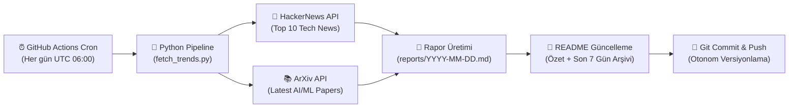

# 📡 AI & Tech Daily Radar

<p align="center">
  
  
  
  
  
</p>

> **AI & Tech Daily Radar**, her gün GitHub Actions üzerinde otonom olarak çalışan; HackerNews üzerindeki en sıcak teknoloji gelişmelerini ve ArXiv üzerindeki en yeni Yapay Zeka / Makine Öğrenimi (AI & ML) araştırma makalelerini toplayıp derleyen modern bir veri hattıdır (data pipeline).

---

<!-- LATEST_REPORT_START -->
### ⚡ Son Güncelleme: `2026-11-10`

> 📊 **Bugünün Özeti:** 10 yüksek nitelikli teknoloji trendi ve 5 ArXiv AI/ML akademik makalesi tarandı.  
> 📑 **Tam Rapor:** [Günün Raporunu Görüntüle (`reports/2026-11-10.md`)](reports/2026-11-10.md)

#### 🔥 HackerNews Öne Çıkanlar
| Kategori | Başlık | Puan | Yorum | HN Linki |
|:--------:|--------|:----:|:-----:|:--------:|
| `🤖 AI / ML` | [Claude Fable 5.2 and Mythos 5.2](https://www.anthropic.com/claude-fable-and-mythos-5-2) | ⭐ 713 | 💬 879 | [Tartışma](https://news.ycombinator.com/item?id=50429068) |
| `💻 Yazılım & Geliştirme` | [USPS now offers official ZIP Code boundary polygons](https://postalpro.usps.com/zcb) | ⭐ 669 | 💬 339 | [Tartışma](https://news.ycombinator.com/item?id=50431058) |
| `🤖 AI / ML` | [Fireworks AI security breach impacts Notion and their customers](https://www.notion.com/help/security-incident-involving-a-third-party-ai-vendor) | ⭐ 92 | 💬 29 | [Tartışma](https://news.ycombinator.com/item?id=50437106) |
| `💻 Yazılım & Geliştirme` | [AlphaProof Code](https://deepmind.google/blog/introducing-alphaproof-code/) | ⭐ 209 | 💬 84 | [Tartışma](https://news.ycombinator.com/item?id=50439193) |
| `🛡️ Güvenlik` | [Queens Public library under ransomware attack e-borrowing suspended](https://connect.queenslibrary.org/) | ⭐ 81 | 💬 61 | [Tartışma](https://news.ycombinator.com/item?id=50437790) |

#### 🤖 ArXiv AI/ML Öne Çıkan Araştırmalar
- 📄 **[Guiding Data Allocation for Robust Subpopulation Generalization](http://arxiv.org/abs/2611.12884v1)** `cs.LG` *(Yazarlar: Zhaoying Pan, Yipei Wang, Shenyu Lu vb.)*
  *Machine learning models often achieve high average accuracy in the training data while performing poorly on test data due to subpopulation shift. A common data-centric solution is to enforce balanced subgroup proportions, but full balance can be costly, infeasible, and not always necessary.*

- 📄 **[Kolmogorov-Chapman Maps: Trajectory-Free Learning for Simulating Molecular Dynamics](http://arxiv.org/abs/2611.12880v1)** `cs.LG` *(Yazarlar: Majdi Hassan, Marta Skreta, Dominique Beaini vb.)*
  *Stochastic differential equations (SDEs) describe stochastic processes across a wide range of scientific domains, including physics, biology, and finance.*

- 📄 **[Adaptive Quantization Preserves Fast Rates for TD Learning over Rate-Limited Channels](http://arxiv.org/abs/2611.12878v1)** `cs.LG` *(Yazarlar: Sreejeet Maity, Aritra Mitra)*
  *Motivated by reinforcement learning subject to communication constraints, we study a policy evaluation problem with linear function approximation over a rate-limited channel.*

#### 🗄️ Son 7 Günün Rapor Arşivi
- [📅 2026-11-10 Raporu](reports/2026-11-10.md)
- [📅 2026-11-08 Raporu](reports/2026-11-08.md)
- [📅 2026-11-07 Raporu](reports/2026-11-07.md)
- [📅 2026-11-06 Raporu](reports/2026-11-06.md)
- [📅 2026-11-05 Raporu](reports/2026-11-05.md)
- [📅 2026-11-04 Raporu](reports/2026-11-04.md)
- [📅 2026-11-03 Raporu](reports/2026-11-03.md)
<!-- LATEST_REPORT_END -->

---

## 🏗️ Mimari ve Nasıl Çalışır?

Bu sistem, harici bir sunucu veya veritabanı ihtiyacı olmadan tamamen **serverless** ve **Git-as-a-Database** yaklaşımıyla çalışacak şekilde tasarlanmıştır:



### ⚙️ Çalışma Aşamaları (ETL)

1. **Extract (Çıkarma):**
   - **HackerNews Algolia API:** Günün en popüler 10 teknoloji trendini (başlık, puan, yorum sayısı, URL) çeker.
   - **ArXiv API:** Bilgisayar Bilimleri / Yapay Zeka (`cs.AI`) ve Makine Öğrenimi (`cs.LG`) kategorilerinde yayımlanan en güncel 5 akademik makaleyi (`ElementTree` XML ayrıştırıcı ile) çeker.

2. **Transform (Dönüştürme):**
   - Alınan ham veriler standart bir Markdown formatına dönüştürülür.
   - Makale özetleri optimize edilir, tablolar ve bağlantılar biçimlendirilir.
   - Son 7 günün arşiv linkleri otomatik tespit edilir.

3. **Load (Yükleme & Dağıtım):**
   - Günün tarihine özel `reports/YYYY-MM-DD.md` dosyası oluşturulur.
   - Ana dizindeki `README.md` dosyasındaki belirlenmiş işaretçiler arasına güncel özet ve arşiv tablosu işlenir.
   - Değişiklikler GitHub Actions botu tarafından depoya geri `commit` ve `push` edilir.

---

## 🚀 Yerel Kurulum ve Çalıştırma

Projeyi yerel makinenizde test etmek isterseniz:

```bash
# 1. Projeyi klonlayın
git clone https://github.com/themuhammedguler/ai-tech-radar.git
cd ai-tech-radar

# 2. Bağımlılıkları yükleyin
pip install -r requirements.txt

# 3. Veri hattını çalıştırın
python src/fetch_trends.py
```

Rapor oluşturulduktan sonra `reports/` dizinini ve `README.md` dosyasını inceleyebilirsiniz.

---

## 📜 Lisans

Bu proje [MIT](LICENSE) lisansı ile lisanslanmıştır.
