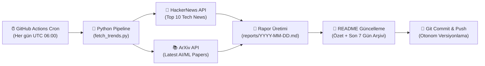

# 📡 AI & Tech Daily Radar

<p align="center">
  
  
  
  
  
</p>

> **AI & Tech Daily Radar**, her gün GitHub Actions üzerinde otonom olarak çalışan; HackerNews üzerindeki en sıcak teknoloji gelişmelerini ve ArXiv üzerindeki en yeni Yapay Zeka / Makine Öğrenimi (AI & ML) araştırma makalelerini toplayıp derleyen modern bir veri hattıdır (data pipeline).

---

<!-- LATEST_REPORT_START -->
### ⚡ Son Güncelleme: `2026-10-13`

> 📊 **Bugünün Özeti:** 10 HackerNews teknoloji trendi ve 5 ArXiv AI/ML akademik makalesi tarandı.  
> 📑 **Tam Rapor:** [Günün Raporunu Görüntüle (`reports/2026-10-13.md`)](reports/2026-10-13.md)

#### 🔥 HackerNews Öne Çıkanlar
| Başlık | Puan | Yorum | HN Linki |
|--------|:----:|:-----:|:--------:|
| [Hackers activate automatic defrosting in supermarket fridges across Europe](https://www.tomshardware.com/tech-industry/cyber-security/unprecedented-cyberattack-cripples-supermarket-fridges-across-europe-as-hackers-activate-automatic-defrosting-delivery-and-store-prices-also-impacted-by-incident) | ⭐ 780 | 💬 898 | [Tartışma](https://news.ycombinator.com/item?id=50055304) |
| [A Modern Web App in C](https://prophitt.me/writing/a-modern-web-app-in-c) | ⭐ 626 | 💬 274 | [Tartışma](https://news.ycombinator.com/item?id=50058528) |
| [GLM-Legal](https://z.ai/blog/glm-legal) | ⭐ 610 | 💬 338 | [Tartışma](https://news.ycombinator.com/item?id=50058507) |
| [AI is a tool and using it well takes skill](https://yyhh.org/blog/2026/10/ai-is-a-tool/) | ⭐ 479 | 💬 387 | [Tartışma](https://news.ycombinator.com/item?id=50063427) |
| [Turn a WiFi 7 Router into a 320Msps Software Defined Radio Receiver](https://github.com/h0m3us3r/w1700k-sdr) | ⭐ 380 | 💬 103 | [Tartışma](https://news.ycombinator.com/item?id=50055593) |

#### 🤖 ArXiv AI/ML Öne Çıkan Araştırmalar
- 📄 **[Can Language Models Play the Wikipedia Game?](http://arxiv.org/abs/2610.13948v1)**
  *Language models increasingly support or automate information retrieval from document collections too large to index. This task is difficult when it requires specialist linguistic or scientific knowled...*

- 📄 **[Hide and Seek: HIDE Concepts to SEEK explanations for black box models](http://arxiv.org/abs/2610.13935v1)**
  *Interpreting machine learning model predictions is a central challenge, particularly for black-box vision models. Concept-based attribution methods interpret models using human-understandable concepts...*

- 📄 **[Constructive Bounds for the Topological Expressivity of Neural Networks](http://arxiv.org/abs/2610.13931v1)**
  *The expressivity of a neural network $Φ$ describes the class of functions that a network can express. The term topological expressivity refers to a family of measures particularly suited to understand...*

#### 🗄️ Son 7 Günün Rapor Arşivi
- [📅 2026-10-13 Raporu](reports/2026-10-13.md)
- [📅 2026-10-12 Raporu](reports/2026-10-12.md)
- [📅 2026-10-11 Raporu](reports/2026-10-11.md)
- [📅 2026-10-10 Raporu](reports/2026-10-10.md)
- [📅 2026-10-09 Raporu](reports/2026-10-09.md)
- [📅 2026-10-08 Raporu](reports/2026-10-08.md)
- [📅 2026-10-07 Raporu](reports/2026-10-07.md)
<!-- LATEST_REPORT_END -->

---

## 🏗️ Mimari ve Nasıl Çalışır?

Bu sistem, harici bir sunucu veya veritabanı ihtiyacı olmadan tamamen **serverless** ve **Git-as-a-Database** yaklaşımıyla çalışacak şekilde tasarlanmıştır:



### ⚙️ Çalışma Aşamaları (ETL)

1. **Extract (Çıkarma):**
   - **HackerNews Algolia API:** Günün en popüler 10 teknoloji trendini (başlık, puan, yorum sayısı, URL) çeker.
   - **ArXiv API:** Bilgisayar Bilimleri / Yapay Zeka (`cs.AI`) ve Makine Öğrenimi (`cs.LG`) kategorilerinde yayımlanan en güncel 5 akademik makaleyi (`ElementTree` XML ayrıştırıcı ile) çeker.

2. **Transform (Dönüştürme):**
   - Alınan ham veriler standart bir Markdown formatına dönüştürülür.
   - Makale özetleri optimize edilir, tablolar ve bağlantılar biçimlendirilir.
   - Son 7 günün arşiv linkleri otomatik tespit edilir.

3. **Load (Yükleme & Dağıtım):**
   - Günün tarihine özel `reports/YYYY-MM-DD.md` dosyası oluşturulur.
   - Ana dizindeki `README.md` dosyasındaki belirlenmiş işaretçiler arasına güncel özet ve arşiv tablosu işlenir.
   - Değişiklikler GitHub Actions botu tarafından depoya geri `commit` ve `push` edilir.

---

## 🚀 Yerel Kurulum ve Çalıştırma

Projeyi yerel makinenizde test etmek isterseniz:

```bash
# 1. Projeyi klonlayın
git clone https://github.com/themuhammedguler/ai-tech-radar.git
cd ai-tech-radar

# 2. Bağımlılıkları yükleyin
pip install -r requirements.txt

# 3. Veri hattını çalıştırın
python src/fetch_trends.py
```

Rapor oluşturulduktan sonra `reports/` dizinini ve `README.md` dosyasını inceleyebilirsiniz.

---

## 📜 Lisans

Bu proje [MIT](LICENSE) lisansı ile lisanslanmıştır.
