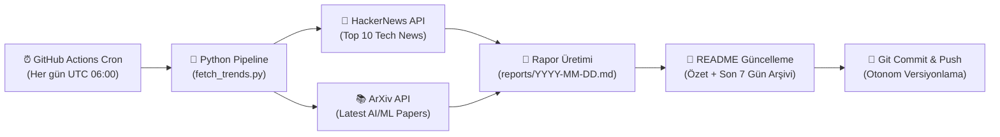

# 📡 AI & Tech Daily Radar

<p align="center">
  
  
  
  
  
</p>

> **AI & Tech Daily Radar**, her gün GitHub Actions üzerinde otonom olarak çalışan; HackerNews üzerindeki en sıcak teknoloji gelişmelerini ve ArXiv üzerindeki en yeni Yapay Zeka / Makine Öğrenimi (AI & ML) araştırma makalelerini toplayıp derleyen modern bir veri hattıdır (data pipeline).

---

<!-- LATEST_REPORT_START -->
### ⚡ Son Güncelleme: `2026-10-21`

> 📊 **Bugünün Özeti:** 10 HackerNews teknoloji trendi ve 5 ArXiv AI/ML akademik makalesi tarandı.  
> 📑 **Tam Rapor:** [Günün Raporunu Görüntüle (`reports/2026-10-21.md`)](reports/2026-10-21.md)

#### 🔥 HackerNews Öne Çıkanlar
| Başlık | Puan | Yorum | HN Linki |
|--------|:----:|:-----:|:--------:|
| [DeepInfer: High-performance inference framework for DeepSeek models](https://github.com/deepseek-ai/DeepInfer) | ⭐ 2259 | 💬 860 | [Tartışma](https://news.ycombinator.com/item?id=50163277) |
| [eMudhra intermediate CA compromise](https://emudhra.we-have-a-problem.com/) | ⭐ 990 | 💬 414 | [Tartışma](https://news.ycombinator.com/item?id=50166579) |
| [Upcoming critical PHP security release (CVE-2026-109618 / -109619)](https://news-web.php.net/php.announce/509) | ⭐ 965 | 💬 389 | [Tartışma](https://news.ycombinator.com/item?id=50172041) |
| [Show HN: SimCity, but with Permits](https://permit.petercai.com/) | ⭐ 813 | 💬 381 | [Tartışma](https://news.ycombinator.com/item?id=50170593) |
| [Voxtral 3](https://mistral.ai/news/voxtral-3/) | ⭐ 690 | 💬 172 | [Tartışma](https://news.ycombinator.com/item?id=50168396) |

#### 🤖 ArXiv AI/ML Öne Çıkan Araştırmalar
- 📄 **[Joints, Camera, Action! Co-Generating 3D Motion and Video for Arbitrary Rigs](http://arxiv.org/abs/2610.28632v1)**
  *Video generation models can now depict remarkably realistic motion. Yet it is unclear how to use this motion beyond pixels: to animate a specific 3D asset and replay the animation in its 3D scene. For...*

- 📄 **[GBClaw: An agentic AI framework for atomistic grain boundary research and mechanistic discovery](http://arxiv.org/abs/2610.28629v1)**
  *Agentic artificial intelligence (AI) systems hold immense potential for automating complex workflows in materials discovery and design, but extending them to domain-intensive mechanistic investigation...*

- 📄 **[Learning Adaptable Dexterous Skills via Hybrid Dexterous Mimicking](http://arxiv.org/abs/2610.28628v1)**
  *Dexterous multi-finger hands hold promise to unlock diverse skills like functional grasps, in-hand reorientation, and dynamic handover that the human-designed world assumes, yet existing learning reci...*

#### 🗄️ Son 7 Günün Rapor Arşivi
- [📅 2026-10-21 Raporu](reports/2026-10-21.md)
- [📅 2026-10-20 Raporu](reports/2026-10-20.md)
- [📅 2026-10-19 Raporu](reports/2026-10-19.md)
- [📅 2026-10-18 Raporu](reports/2026-10-18.md)
- [📅 2026-10-17 Raporu](reports/2026-10-17.md)
- [📅 2026-10-16 Raporu](reports/2026-10-16.md)
- [📅 2026-10-15 Raporu](reports/2026-10-15.md)
<!-- LATEST_REPORT_END -->

---

## 🏗️ Mimari ve Nasıl Çalışır?

Bu sistem, harici bir sunucu veya veritabanı ihtiyacı olmadan tamamen **serverless** ve **Git-as-a-Database** yaklaşımıyla çalışacak şekilde tasarlanmıştır:



### ⚙️ Çalışma Aşamaları (ETL)

1. **Extract (Çıkarma):**
   - **HackerNews Algolia API:** Günün en popüler 10 teknoloji trendini (başlık, puan, yorum sayısı, URL) çeker.
   - **ArXiv API:** Bilgisayar Bilimleri / Yapay Zeka (`cs.AI`) ve Makine Öğrenimi (`cs.LG`) kategorilerinde yayımlanan en güncel 5 akademik makaleyi (`ElementTree` XML ayrıştırıcı ile) çeker.

2. **Transform (Dönüştürme):**
   - Alınan ham veriler standart bir Markdown formatına dönüştürülür.
   - Makale özetleri optimize edilir, tablolar ve bağlantılar biçimlendirilir.
   - Son 7 günün arşiv linkleri otomatik tespit edilir.

3. **Load (Yükleme & Dağıtım):**
   - Günün tarihine özel `reports/YYYY-MM-DD.md` dosyası oluşturulur.
   - Ana dizindeki `README.md` dosyasındaki belirlenmiş işaretçiler arasına güncel özet ve arşiv tablosu işlenir.
   - Değişiklikler GitHub Actions botu tarafından depoya geri `commit` ve `push` edilir.

---

## 🚀 Yerel Kurulum ve Çalıştırma

Projeyi yerel makinenizde test etmek isterseniz:

```bash
# 1. Projeyi klonlayın
git clone https://github.com/themuhammedguler/ai-tech-radar.git
cd ai-tech-radar

# 2. Bağımlılıkları yükleyin
pip install -r requirements.txt

# 3. Veri hattını çalıştırın
python src/fetch_trends.py
```

Rapor oluşturulduktan sonra `reports/` dizinini ve `README.md` dosyasını inceleyebilirsiniz.

---

## 📜 Lisans

Bu proje [MIT](LICENSE) lisansı ile lisanslanmıştır.
