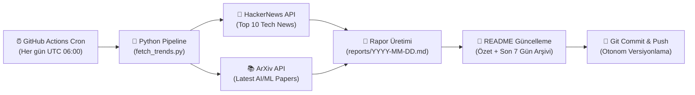

# 📡 AI & Tech Daily Radar

<p align="center">
  
  
  
  
  
</p>

> **AI & Tech Daily Radar**, her gün GitHub Actions üzerinde otonom olarak çalışan; HackerNews üzerindeki en sıcak teknoloji gelişmelerini ve ArXiv üzerindeki en yeni Yapay Zeka / Makine Öğrenimi (AI & ML) araştırma makalelerini toplayıp derleyen modern bir veri hattıdır (data pipeline).

---

<!-- LATEST_REPORT_START -->
### ⚡ Son Güncelleme: `2026-10-27`

> 📊 **Bugünün Özeti:** 10 HackerNews teknoloji trendi ve 5 ArXiv AI/ML akademik makalesi tarandı.  
> 📑 **Tam Rapor:** [Günün Raporunu Görüntüle (`reports/2026-10-27.md`)](reports/2026-10-27.md)

#### 🔥 HackerNews Öne Çıkanlar
| Başlık | Puan | Yorum | HN Linki |
|--------|:----:|:-----:|:--------:|
| [Anthropic S-1](https://www.sec.gov/Archives/edgar/data/2130357/000162828026067168/anthropicpbc-sx1.htm) | ⭐ 1627 | 💬 1554 | [Tartışma](https://news.ycombinator.com/item?id=50242939) |
| [Three new discoveries in mathematics, computer science, and physics](https://openai.com/index/building-scientific-understanding-with-academic-communities/) | ⭐ 951 | 💬 481 | [Tartışma](https://news.ycombinator.com/item?id=50251344) |
| [Sebastian Raschka's from-scratch video course on building reasoning models](https://magazine.sebastianraschka.com/p/building-reasoning-models) | ⭐ 727 | 💬 101 | [Tartışma](https://news.ycombinator.com/item?id=50245138) |
| [The Exponential Time Hypothesis Is False [pdf]](https://github.com/openai/math/blob/main/preprints/The-Exponential-Time-Hypothesis-is-False-October-25-2026/paper.pdf) | ⭐ 650 | 💬 242 | [Tartışma](https://news.ycombinator.com/item?id=50251661) |
| [CSS-Tricks has a new owner](https://css-tricks.com/css-tricks-has-a-new-owner/) | ⭐ 492 | 💬 106 | [Tartışma](https://news.ycombinator.com/item?id=50245831) |

#### 🤖 ArXiv AI/ML Öne Çıkan Araştırmalar
- 📄 **[Retriever-Free Retrieval: Navigating Documents with Decision Models](http://arxiv.org/abs/2610.35868v1)**
  *While language models have become dramatically more capable, retrieval still largely relies on lexical matching or similarity in fixed embedding spaces. This creates a capability asymmetry: what the r...*

- 📄 **[Center-of-Mass Interpretation of Evolution Strategies](http://arxiv.org/abs/2610.35865v1)**
  *Evolution strategies (ES) update a model by sampling a population of perturbed copies, scoring each one, and moving in the reward-weighted direction of the perturbations. This update is usually presen...*

- 📄 **[Auto-Research Arena: Benchmarking and Advancing Auto-Research in Language Modeling](http://arxiv.org/abs/2610.35866v1)**
  *As autonomous research systems become more capable, benchmarks must both evaluate their performance and support meaningful research progress. We introduce Auto-Research Arena, a multi-target benchmark...*

#### 🗄️ Son 7 Günün Rapor Arşivi
- [📅 2026-10-27 Raporu](reports/2026-10-27.md)
- [📅 2026-10-26 Raporu](reports/2026-10-26.md)
- [📅 2026-10-25 Raporu](reports/2026-10-25.md)
- [📅 2026-10-24 Raporu](reports/2026-10-24.md)
- [📅 2026-10-23 Raporu](reports/2026-10-23.md)
- [📅 2026-10-22 Raporu](reports/2026-10-22.md)
- [📅 2026-10-21 Raporu](reports/2026-10-21.md)
<!-- LATEST_REPORT_END -->

---

## 🏗️ Mimari ve Nasıl Çalışır?

Bu sistem, harici bir sunucu veya veritabanı ihtiyacı olmadan tamamen **serverless** ve **Git-as-a-Database** yaklaşımıyla çalışacak şekilde tasarlanmıştır:



### ⚙️ Çalışma Aşamaları (ETL)

1. **Extract (Çıkarma):**
   - **HackerNews Algolia API:** Günün en popüler 10 teknoloji trendini (başlık, puan, yorum sayısı, URL) çeker.
   - **ArXiv API:** Bilgisayar Bilimleri / Yapay Zeka (`cs.AI`) ve Makine Öğrenimi (`cs.LG`) kategorilerinde yayımlanan en güncel 5 akademik makaleyi (`ElementTree` XML ayrıştırıcı ile) çeker.

2. **Transform (Dönüştürme):**
   - Alınan ham veriler standart bir Markdown formatına dönüştürülür.
   - Makale özetleri optimize edilir, tablolar ve bağlantılar biçimlendirilir.
   - Son 7 günün arşiv linkleri otomatik tespit edilir.

3. **Load (Yükleme & Dağıtım):**
   - Günün tarihine özel `reports/YYYY-MM-DD.md` dosyası oluşturulur.
   - Ana dizindeki `README.md` dosyasındaki belirlenmiş işaretçiler arasına güncel özet ve arşiv tablosu işlenir.
   - Değişiklikler GitHub Actions botu tarafından depoya geri `commit` ve `push` edilir.

---

## 🚀 Yerel Kurulum ve Çalıştırma

Projeyi yerel makinenizde test etmek isterseniz:

```bash
# 1. Projeyi klonlayın
git clone https://github.com/themuhammedguler/ai-tech-radar.git
cd ai-tech-radar

# 2. Bağımlılıkları yükleyin
pip install -r requirements.txt

# 3. Veri hattını çalıştırın
python src/fetch_trends.py
```

Rapor oluşturulduktan sonra `reports/` dizinini ve `README.md` dosyasını inceleyebilirsiniz.

---

## 📜 Lisans

Bu proje [MIT](LICENSE) lisansı ile lisanslanmıştır.
