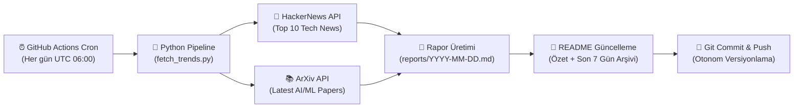

# 📡 AI & Tech Daily Radar

<p align="center">
  
  
  
  
  
</p>

> **AI & Tech Daily Radar**, her gün GitHub Actions üzerinde otonom olarak çalışan; HackerNews üzerindeki en sıcak teknoloji gelişmelerini ve ArXiv üzerindeki en yeni Yapay Zeka / Makine Öğrenimi (AI & ML) araştırma makalelerini toplayıp derleyen modern bir veri hattıdır (data pipeline).

---

<!-- LATEST_REPORT_START -->
### ⚡ Son Güncelleme: `2026-11-05`

> 📊 **Bugünün Özeti:** 10 HackerNews teknoloji trendi ve 5 ArXiv AI/ML akademik makalesi tarandı.  
> 📑 **Tam Rapor:** [Günün Raporunu Görüntüle (`reports/2026-11-05.md`)](reports/2026-11-05.md)

#### 🔥 HackerNews Öne Çıkanlar
| Başlık | Puan | Yorum | HN Linki |
|--------|:----:|:-----:|:--------:|
| [AI is forcing us to pay off 40 years of technical debt](https://spectrum.ieee.org/ai-in-cybersecurity-php2shell-vulnerability) | ⭐ 1222 | 💬 712 | [Tartışma](https://news.ycombinator.com/item?id=50364336) |
| [Residential proxies detected on White House network](https://layer3intel.com/blog/residential-proxies-white-house-network) | ⭐ 1166 | 💬 377 | [Tartışma](https://news.ycombinator.com/item?id=50371246) |
| [Kimi K3.1 Pro model weights are out](https://huggingface.co/moonshotai/Kimi-K3.1-Pro) | ⭐ 577 | 💬 164 | [Tartışma](https://news.ycombinator.com/item?id=50366999) |
| [Sshole](https://sshhole.com) | ⭐ 435 | 💬 99 | [Tartışma](https://news.ycombinator.com/item?id=50378228) |
| [A thousand fewer paths to root](https://openai.com/index/a-thousand-fewer-paths-to-root/) | ⭐ 419 | 💬 300 | [Tartışma](https://news.ycombinator.com/item?id=50372929) |

#### 🤖 ArXiv AI/ML Öne Çıkan Araştırmalar
- 📄 **[A Framework for Context Enrichment and Selective Robustness in LLM Social Agents](http://arxiv.org/abs/2611.06914v1)**
  *Researchers use large language models as agents in social simulations, where agents are prompted with observations and background information intended to shape their actions. Yet LLM agents have been...*

- 📄 **[FlowReconBench: Accuracy, calibration and cost of learned and classical flow reconstruction from sparse sensors](http://arxiv.org/abs/2611.06912v1)**
  *Reconstructing full flow fields from sparse sensors requires prior assumptions about unmeasured regions and physical variables. Yet it remains unclear when learned models outperform classical estimato...*

- 📄 **[BEAKER: An Expert-Curated Benchmark for Embodied Brains in Self-Driving Chemical Laboratories](http://arxiv.org/abs/2611.06911v1)**
  *Self-Driving Chemical Laboratories (SDCLs) are moving chemical experimentation toward embodied automation, where machines must perceive laboratory scenes, reason about experimental states, and act und...*

#### 🗄️ Son 7 Günün Rapor Arşivi
- [📅 2026-11-05 Raporu](reports/2026-11-05.md)
- [📅 2026-11-04 Raporu](reports/2026-11-04.md)
- [📅 2026-11-03 Raporu](reports/2026-11-03.md)
- [📅 2026-11-02 Raporu](reports/2026-11-02.md)
- [📅 2026-11-01 Raporu](reports/2026-11-01.md)
- [📅 2026-10-31 Raporu](reports/2026-10-31.md)
- [📅 2026-10-30 Raporu](reports/2026-10-30.md)
<!-- LATEST_REPORT_END -->

---

## 🏗️ Mimari ve Nasıl Çalışır?

Bu sistem, harici bir sunucu veya veritabanı ihtiyacı olmadan tamamen **serverless** ve **Git-as-a-Database** yaklaşımıyla çalışacak şekilde tasarlanmıştır:



### ⚙️ Çalışma Aşamaları (ETL)

1. **Extract (Çıkarma):**
   - **HackerNews Algolia API:** Günün en popüler 10 teknoloji trendini (başlık, puan, yorum sayısı, URL) çeker.
   - **ArXiv API:** Bilgisayar Bilimleri / Yapay Zeka (`cs.AI`) ve Makine Öğrenimi (`cs.LG`) kategorilerinde yayımlanan en güncel 5 akademik makaleyi (`ElementTree` XML ayrıştırıcı ile) çeker.

2. **Transform (Dönüştürme):**
   - Alınan ham veriler standart bir Markdown formatına dönüştürülür.
   - Makale özetleri optimize edilir, tablolar ve bağlantılar biçimlendirilir.
   - Son 7 günün arşiv linkleri otomatik tespit edilir.

3. **Load (Yükleme & Dağıtım):**
   - Günün tarihine özel `reports/YYYY-MM-DD.md` dosyası oluşturulur.
   - Ana dizindeki `README.md` dosyasındaki belirlenmiş işaretçiler arasına güncel özet ve arşiv tablosu işlenir.
   - Değişiklikler GitHub Actions botu tarafından depoya geri `commit` ve `push` edilir.

---

## 🚀 Yerel Kurulum ve Çalıştırma

Projeyi yerel makinenizde test etmek isterseniz:

```bash
# 1. Projeyi klonlayın
git clone https://github.com/themuhammedguler/ai-tech-radar.git
cd ai-tech-radar

# 2. Bağımlılıkları yükleyin
pip install -r requirements.txt

# 3. Veri hattını çalıştırın
python src/fetch_trends.py
```

Rapor oluşturulduktan sonra `reports/` dizinini ve `README.md` dosyasını inceleyebilirsiniz.

---

## 📜 Lisans

Bu proje [MIT](LICENSE) lisansı ile lisanslanmıştır.
