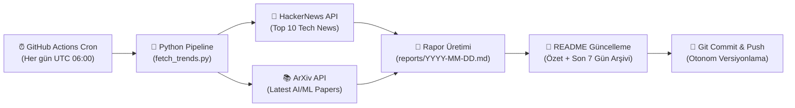

# 📡 AI & Tech Daily Radar

<p align="center">
  
  
  
  
  
</p>

> **AI & Tech Daily Radar**, her gün GitHub Actions üzerinde otonom olarak çalışan; HackerNews üzerindeki en sıcak teknoloji gelişmelerini ve ArXiv üzerindeki en yeni Yapay Zeka / Makine Öğrenimi (AI & ML) araştırma makalelerini toplayıp derleyen modern bir veri hattıdır (data pipeline).

---

<!-- LATEST_REPORT_START -->
### ⚡ Son Güncelleme: `2026-10-15`

> 📊 **Bugünün Özeti:** 10 HackerNews teknoloji trendi ve 5 ArXiv AI/ML akademik makalesi tarandı.  
> 📑 **Tam Rapor:** [Günün Raporunu Görüntüle (`reports/2026-10-15.md`)](reports/2026-10-15.md)

#### 🔥 HackerNews Öne Çıkanlar
| Başlık | Puan | Yorum | HN Linki |
|--------|:----:|:-----:|:--------:|
| [Things to know when you get cancer](https://jjmaxwell4.com/writing/things-to-know-when-you-get-cancer/) | ⭐ 1411 | 💬 350 | [Tartışma](https://news.ycombinator.com/item?id=50093568) |
| [Containment and monitoring failures are to blame for AI hacking reports: experts](https://www.csoonline.com/article/4234854/ai-agents-arent-going-rogue-frontier-labs-are-skipping-security-basics.html) | ⭐ 907 | 💬 538 | [Tartışma](https://news.ycombinator.com/item?id=50091788) |
| [How Amazon pushes up prices all across the Internet](https://www.not-ship.com/how-amazon-pushes-up-prices-all-across-the-internet/) | ⭐ 844 | 💬 647 | [Tartışma](https://news.ycombinator.com/item?id=50084757) |
| [Do dentists know what they're doing?](https://mapwriting.substack.com/p/dentists) | ⭐ 724 | 💬 523 | [Tartışma](https://news.ycombinator.com/item?id=50050553) |
| [OpenCode 2.0](https://anoma.ly/notes/opencode-2-0/) | ⭐ 629 | 💬 249 | [Tartışma](https://news.ycombinator.com/item?id=50094994) |

#### 🤖 ArXiv AI/ML Öne Çıkan Araştırmalar
- 📄 **[Modeling and Understanding Neural Weights of Humanoid Policies with Diffusion](http://arxiv.org/abs/2610.20606v1)**
  *Recent advances in robot learning have driven rapid progress in humanoid control, enabling increasingly agile behaviors in the real world. However, humanoid control networks are typically obtained thr...*

- 📄 **[Hierarchical Residual Policy Learning for Real-World Mobile Manipulation with Sparse Human Guidance](http://arxiv.org/abs/2610.20607v1)**
  *Mobile Manipulation (MoMa) is a cornerstone of autonomous robotic systems, yet real-world fine-tuning remains a formidable challenge because of high-dimensional action spaces and intricate coupling be...*

- 📄 **[Co-Evolving Acting and Forecasting for Language Agents](http://arxiv.org/abs/2610.20597v1)**
  *Training language agents is bottlenecked by the high cost of long-horizon rollouts, yet standard agentic reinforcement learning (RL) learns only from a terminal scalar reward, leaving the supervision...*

#### 🗄️ Son 7 Günün Rapor Arşivi
- [📅 2026-10-15 Raporu](reports/2026-10-15.md)
- [📅 2026-10-14 Raporu](reports/2026-10-14.md)
- [📅 2026-10-13 Raporu](reports/2026-10-13.md)
- [📅 2026-10-12 Raporu](reports/2026-10-12.md)
- [📅 2026-10-11 Raporu](reports/2026-10-11.md)
- [📅 2026-10-10 Raporu](reports/2026-10-10.md)
- [📅 2026-10-09 Raporu](reports/2026-10-09.md)
<!-- LATEST_REPORT_END -->

---

## 🏗️ Mimari ve Nasıl Çalışır?

Bu sistem, harici bir sunucu veya veritabanı ihtiyacı olmadan tamamen **serverless** ve **Git-as-a-Database** yaklaşımıyla çalışacak şekilde tasarlanmıştır:



### ⚙️ Çalışma Aşamaları (ETL)

1. **Extract (Çıkarma):**
   - **HackerNews Algolia API:** Günün en popüler 10 teknoloji trendini (başlık, puan, yorum sayısı, URL) çeker.
   - **ArXiv API:** Bilgisayar Bilimleri / Yapay Zeka (`cs.AI`) ve Makine Öğrenimi (`cs.LG`) kategorilerinde yayımlanan en güncel 5 akademik makaleyi (`ElementTree` XML ayrıştırıcı ile) çeker.

2. **Transform (Dönüştürme):**
   - Alınan ham veriler standart bir Markdown formatına dönüştürülür.
   - Makale özetleri optimize edilir, tablolar ve bağlantılar biçimlendirilir.
   - Son 7 günün arşiv linkleri otomatik tespit edilir.

3. **Load (Yükleme & Dağıtım):**
   - Günün tarihine özel `reports/YYYY-MM-DD.md` dosyası oluşturulur.
   - Ana dizindeki `README.md` dosyasındaki belirlenmiş işaretçiler arasına güncel özet ve arşiv tablosu işlenir.
   - Değişiklikler GitHub Actions botu tarafından depoya geri `commit` ve `push` edilir.

---

## 🚀 Yerel Kurulum ve Çalıştırma

Projeyi yerel makinenizde test etmek isterseniz:

```bash
# 1. Projeyi klonlayın
git clone https://github.com/themuhammedguler/ai-tech-radar.git
cd ai-tech-radar

# 2. Bağımlılıkları yükleyin
pip install -r requirements.txt

# 3. Veri hattını çalıştırın
python src/fetch_trends.py
```

Rapor oluşturulduktan sonra `reports/` dizinini ve `README.md` dosyasını inceleyebilirsiniz.

---

## 📜 Lisans

Bu proje [MIT](LICENSE) lisansı ile lisanslanmıştır.
