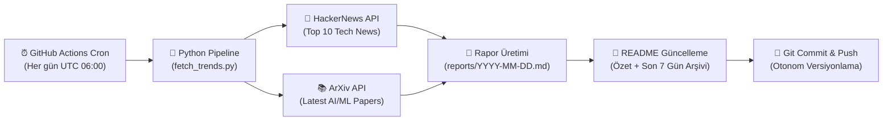

# 📡 AI & Tech Daily Radar

<p align="center">
  
  
  
  
  
</p>

> **AI & Tech Daily Radar**, her gün GitHub Actions üzerinde otonom olarak çalışan; HackerNews üzerindeki en sıcak teknoloji gelişmelerini ve ArXiv üzerindeki en yeni Yapay Zeka / Makine Öğrenimi (AI & ML) araştırma makalelerini toplayıp derleyen modern bir veri hattıdır (data pipeline).

---

<!-- LATEST_REPORT_START -->
### ⚡ Son Güncelleme: `2026-11-06`

> 📊 **Bugünün Özeti:** 10 HackerNews teknoloji trendi ve 5 ArXiv AI/ML akademik makalesi tarandı.  
> 📑 **Tam Rapor:** [Günün Raporunu Görüntüle (`reports/2026-11-06.md`)](reports/2026-11-06.md)

#### 🔥 HackerNews Öne Çıkanlar
| Başlık | Puan | Yorum | HN Linki |
|--------|:----:|:-----:|:--------:|
| [sshole](https://sshhole.com) | ⭐ 2789 | 💬 676 | [Tartışma](https://news.ycombinator.com/item?id=50378228) |
| [Claude Code sends your email address to websites](https://github.com/anthropics/claude-code/issues/107757) | ⭐ 1295 | 💬 408 | [Tartışma](https://news.ycombinator.com/item?id=50385272) |
| [MS Paint Remote Code Execution Vulnerability](https://www.cve.org/CVERecord?id=CVE-2026-83844) | ⭐ 598 | 💬 222 | [Tartışma](https://news.ycombinator.com/item?id=50384233) |
| [Motorola Signature 27 with GrapheneOS support](https://motorolanews.com/motorola-signature-27-2/) | ⭐ 520 | 💬 371 | [Tartışma](https://news.ycombinator.com/item?id=50380810) |
| [I wish tech companies knew more about me](https://rakhim.exotext.com/i-wish-tech-companies-knew-more-about-me) | ⭐ 477 | 💬 378 | [Tartışma](https://news.ycombinator.com/item?id=50378942) |

#### 🤖 ArXiv AI/ML Öne Çıkan Araştırmalar
- 📄 **[User Embeddings are Superpositions of Interpretable Behavioral Modes](http://arxiv.org/abs/2611.08487v1)**
  *User embeddings are central components of modern recommendation, personalization, and behavioral modeling systems. Though these embeddings can compactly encode rich behavioral information, they are in...*

- 📄 **[SwarmEvolve: Latent Agent Swarms for Evolutionary Discovery and Optimization](http://arxiv.org/abs/2611.08483v1)**
  *LLM-guided evolutionary search uses AI agents to improve programs for mathematical and computational problems by iteratively refining solutions and combining high-scoring methods. However, the process...*

- 📄 **[Scientist World: Grow a Research World for AI-Scientists](http://arxiv.org/abs/2611.08478v1)**
  *AI-Scientists arrived, but a world for them to grow in did not. Human scientists take theirs for granted $-$ centuries of open problems and shared ideas, waiting in the scientific literature. To AI-Sc...*

#### 🗄️ Son 7 Günün Rapor Arşivi
- [📅 2026-11-06 Raporu](reports/2026-11-06.md)
- [📅 2026-11-05 Raporu](reports/2026-11-05.md)
- [📅 2026-11-04 Raporu](reports/2026-11-04.md)
- [📅 2026-11-03 Raporu](reports/2026-11-03.md)
- [📅 2026-11-02 Raporu](reports/2026-11-02.md)
- [📅 2026-11-01 Raporu](reports/2026-11-01.md)
- [📅 2026-10-31 Raporu](reports/2026-10-31.md)
<!-- LATEST_REPORT_END -->

---

## 🏗️ Mimari ve Nasıl Çalışır?

Bu sistem, harici bir sunucu veya veritabanı ihtiyacı olmadan tamamen **serverless** ve **Git-as-a-Database** yaklaşımıyla çalışacak şekilde tasarlanmıştır:



### ⚙️ Çalışma Aşamaları (ETL)

1. **Extract (Çıkarma):**
   - **HackerNews Algolia API:** Günün en popüler 10 teknoloji trendini (başlık, puan, yorum sayısı, URL) çeker.
   - **ArXiv API:** Bilgisayar Bilimleri / Yapay Zeka (`cs.AI`) ve Makine Öğrenimi (`cs.LG`) kategorilerinde yayımlanan en güncel 5 akademik makaleyi (`ElementTree` XML ayrıştırıcı ile) çeker.

2. **Transform (Dönüştürme):**
   - Alınan ham veriler standart bir Markdown formatına dönüştürülür.
   - Makale özetleri optimize edilir, tablolar ve bağlantılar biçimlendirilir.
   - Son 7 günün arşiv linkleri otomatik tespit edilir.

3. **Load (Yükleme & Dağıtım):**
   - Günün tarihine özel `reports/YYYY-MM-DD.md` dosyası oluşturulur.
   - Ana dizindeki `README.md` dosyasındaki belirlenmiş işaretçiler arasına güncel özet ve arşiv tablosu işlenir.
   - Değişiklikler GitHub Actions botu tarafından depoya geri `commit` ve `push` edilir.

---

## 🚀 Yerel Kurulum ve Çalıştırma

Projeyi yerel makinenizde test etmek isterseniz:

```bash
# 1. Projeyi klonlayın
git clone https://github.com/themuhammedguler/ai-tech-radar.git
cd ai-tech-radar

# 2. Bağımlılıkları yükleyin
pip install -r requirements.txt

# 3. Veri hattını çalıştırın
python src/fetch_trends.py
```

Rapor oluşturulduktan sonra `reports/` dizinini ve `README.md` dosyasını inceleyebilirsiniz.

---

## 📜 Lisans

Bu proje [MIT](LICENSE) lisansı ile lisanslanmıştır.
