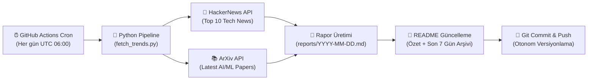

# 📡 AI & Tech Daily Radar

<p align="center">
  
  
  
  
  
</p>

> **AI & Tech Daily Radar**, her gün GitHub Actions üzerinde otonom olarak çalışan; HackerNews üzerindeki en sıcak teknoloji gelişmelerini ve ArXiv üzerindeki en yeni Yapay Zeka / Makine Öğrenimi (AI & ML) araştırma makalelerini toplayıp derleyen modern bir veri hattıdır (data pipeline).

---

<!-- LATEST_REPORT_START -->
### ⚡ Son Güncelleme: `2026-11-04`

> 📊 **Bugünün Özeti:** 10 HackerNews teknoloji trendi ve 5 ArXiv AI/ML akademik makalesi tarandı.  
> 📑 **Tam Rapor:** [Günün Raporunu Görüntüle (`reports/2026-11-04.md`)](reports/2026-11-04.md)

#### 🔥 HackerNews Öne Çıkanlar
| Başlık | Puan | Yorum | HN Linki |
|--------|:----:|:-----:|:--------:|
| [Postman silently auto-installs AI plugins and attempts to share all API data](https://github.com/postmanlabs/postman-app-support/issues/14370) | ⭐ 1376 | 💬 456 | [Tartışma](https://news.ycombinator.com/item?id=50354960) |
| [Jailbreaking my car's navigation system just so I can change the time](https://blog.nns.ee/2026/11/02/renault-hack/) | ⭐ 877 | 💬 331 | [Tartışma](https://news.ycombinator.com/item?id=50339288) |
| [Stringman, an $800 open-source room scale gripper robot](https://neufangled.com/) | ⭐ 667 | 💬 210 | [Tartışma](https://news.ycombinator.com/item?id=50354358) |
| [Qwen 3.8 27B on my laptop can interpret model weights, too](https://simonwillison.net/2026/Nov/3/qwen-can-interpret-model-weights/) | ⭐ 667 | 💬 194 | [Tartışma](https://news.ycombinator.com/item?id=50355251) |
| [Fujifilm to boost tape production 5x as AI fuels archiving demand](https://arstechnica.com/gadgets/2026/10/fujifilm-to-boost-tape-production-5x-as-ai-fuels-archiving-demand/) | ⭐ 496 | 💬 211 | [Tartışma](https://news.ycombinator.com/item?id=50336918) |

#### 🤖 ArXiv AI/ML Öne Çıkan Araştırmalar
- 📄 **[DreamX: Video Diffusion Model is a Universal Latent Action Learner](http://arxiv.org/abs/2611.05377v1)**
  *Learning a universal action representation from video requires modeling dynamics that are consistent across different executions of the same action yet invariant to changes in embodiment and appearanc...*

- 📄 **[From Autonomous Agents to Cognitive Symbionts: Toward AI-Augmented Human Intelligence](http://arxiv.org/abs/2611.05376v1)**
  *For a decade, progress in artificial intelligence has been measured by how much a machine can do on its own. Large foundation models now write code and run multistep tasks, and personal agents act on...*

- 📄 **[Aligning Language Models with General Preferences: An Empirical Study of Direct Nash Optimization](http://arxiv.org/abs/2611.05373v1)**
  *Direct Nash Optimization (DNO) aligns a language model to a general preference function by approximating the Nash equilibrium of a two-player preference game. Its practical variant, DNO-Prct, iterates...*

#### 🗄️ Son 7 Günün Rapor Arşivi
- [📅 2026-11-04 Raporu](reports/2026-11-04.md)
- [📅 2026-11-03 Raporu](reports/2026-11-03.md)
- [📅 2026-11-02 Raporu](reports/2026-11-02.md)
- [📅 2026-11-01 Raporu](reports/2026-11-01.md)
- [📅 2026-10-31 Raporu](reports/2026-10-31.md)
- [📅 2026-10-30 Raporu](reports/2026-10-30.md)
- [📅 2026-10-29 Raporu](reports/2026-10-29.md)
<!-- LATEST_REPORT_END -->

---

## 🏗️ Mimari ve Nasıl Çalışır?

Bu sistem, harici bir sunucu veya veritabanı ihtiyacı olmadan tamamen **serverless** ve **Git-as-a-Database** yaklaşımıyla çalışacak şekilde tasarlanmıştır:



### ⚙️ Çalışma Aşamaları (ETL)

1. **Extract (Çıkarma):**
   - **HackerNews Algolia API:** Günün en popüler 10 teknoloji trendini (başlık, puan, yorum sayısı, URL) çeker.
   - **ArXiv API:** Bilgisayar Bilimleri / Yapay Zeka (`cs.AI`) ve Makine Öğrenimi (`cs.LG`) kategorilerinde yayımlanan en güncel 5 akademik makaleyi (`ElementTree` XML ayrıştırıcı ile) çeker.

2. **Transform (Dönüştürme):**
   - Alınan ham veriler standart bir Markdown formatına dönüştürülür.
   - Makale özetleri optimize edilir, tablolar ve bağlantılar biçimlendirilir.
   - Son 7 günün arşiv linkleri otomatik tespit edilir.

3. **Load (Yükleme & Dağıtım):**
   - Günün tarihine özel `reports/YYYY-MM-DD.md` dosyası oluşturulur.
   - Ana dizindeki `README.md` dosyasındaki belirlenmiş işaretçiler arasına güncel özet ve arşiv tablosu işlenir.
   - Değişiklikler GitHub Actions botu tarafından depoya geri `commit` ve `push` edilir.

---

## 🚀 Yerel Kurulum ve Çalıştırma

Projeyi yerel makinenizde test etmek isterseniz:

```bash
# 1. Projeyi klonlayın
git clone https://github.com/themuhammedguler/ai-tech-radar.git
cd ai-tech-radar

# 2. Bağımlılıkları yükleyin
pip install -r requirements.txt

# 3. Veri hattını çalıştırın
python src/fetch_trends.py
```

Rapor oluşturulduktan sonra `reports/` dizinini ve `README.md` dosyasını inceleyebilirsiniz.

---

## 📜 Lisans

Bu proje [MIT](LICENSE) lisansı ile lisanslanmıştır.
