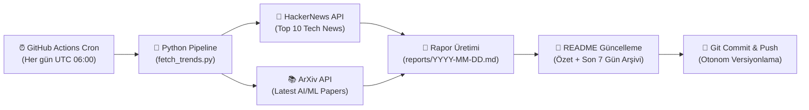

# 📡 AI & Tech Daily Radar

<p align="center">
  
  
  
  
  
</p>

> **AI & Tech Daily Radar**, her gün GitHub Actions üzerinde otonom olarak çalışan; HackerNews üzerindeki en sıcak teknoloji gelişmelerini ve ArXiv üzerindeki en yeni Yapay Zeka / Makine Öğrenimi (AI & ML) araştırma makalelerini toplayıp derleyen modern bir veri hattıdır (data pipeline).

---

<!-- LATEST_REPORT_START -->
### ⚡ Son Güncelleme: `2026-10-20`

> 📊 **Bugünün Özeti:** 10 HackerNews teknoloji trendi ve 5 ArXiv AI/ML akademik makalesi tarandı.  
> 📑 **Tam Rapor:** [Günün Raporunu Görüntüle (`reports/2026-10-20.md`)](reports/2026-10-20.md)

#### 🔥 HackerNews Öne Çıkanlar
| Başlık | Puan | Yorum | HN Linki |
|--------|:----:|:-----:|:--------:|
| [It's still ok to enjoy programming](https://chriskiehl.com/article/it-is-still-ok-to-enjoy-programming) | ⭐ 612 | 💬 528 | [Tartışma](https://news.ycombinator.com/item?id=50134472) |
| [Wine ported to OpenBSD](https://marc.info/?l=openbsd-ports&m=179236125692175) | ⭐ 573 | 💬 195 | [Tartışma](https://news.ycombinator.com/item?id=50152307) |
| [I built a drone with only one motor [video]](https://www.youtube.com/watch?v=Ndftcft6XhU) | ⭐ 558 | 💬 120 | [Tartışma](https://news.ycombinator.com/item?id=50150089) |
| [MiniMax M3.1 Flash](https://www.minimax.io/blog/minimax-m31f) | ⭐ 469 | 💬 199 | [Tartışma](https://news.ycombinator.com/item?id=50154540) |
| [Starcraft: Ashfall](https://starcraft-shooter-2026.pages.dev/) | ⭐ 468 | 💬 146 | [Tartışma](https://news.ycombinator.com/item?id=50147233) |

#### 🤖 ArXiv AI/ML Öne Çıkan Araştırmalar
- 📄 **[Text-to-Image Generative Modeling Without Language Pretraining](http://arxiv.org/abs/2610.26863v1)**
  *Modern text-to-image (T2I) systems use internet-scale language pretraining for text-conditioned image generation. We ask whether language pretraining is necessary for strong T2I generation. We introdu...*

- 📄 **[OpenVLHarness: Real World Visual Agentic Tool-Use with Multimodal Memory](http://arxiv.org/abs/2610.26860v1)**
  *Multimodal large language models (MLLMs) have made rapid progress on visual reasoning, yet many tasks require evidence that is difficult to obtain through internal reasoning alone: our controlled stud...*

- 📄 **[Reinforcement Learning with Visually Attributable On-Policy Self-Distillation](http://arxiv.org/abs/2610.26856v1)**
  *Multimodal reinforcement learning with verifiable rewards (RLVR) provides reliable task-level supervision, yet offers limited guidance for localizing errors in visual reasoning. On-policy self-distill...*

#### 🗄️ Son 7 Günün Rapor Arşivi
- [📅 2026-10-20 Raporu](reports/2026-10-20.md)
- [📅 2026-10-19 Raporu](reports/2026-10-19.md)
- [📅 2026-10-18 Raporu](reports/2026-10-18.md)
- [📅 2026-10-17 Raporu](reports/2026-10-17.md)
- [📅 2026-10-16 Raporu](reports/2026-10-16.md)
- [📅 2026-10-15 Raporu](reports/2026-10-15.md)
- [📅 2026-10-14 Raporu](reports/2026-10-14.md)
<!-- LATEST_REPORT_END -->

---

## 🏗️ Mimari ve Nasıl Çalışır?

Bu sistem, harici bir sunucu veya veritabanı ihtiyacı olmadan tamamen **serverless** ve **Git-as-a-Database** yaklaşımıyla çalışacak şekilde tasarlanmıştır:



### ⚙️ Çalışma Aşamaları (ETL)

1. **Extract (Çıkarma):**
   - **HackerNews Algolia API:** Günün en popüler 10 teknoloji trendini (başlık, puan, yorum sayısı, URL) çeker.
   - **ArXiv API:** Bilgisayar Bilimleri / Yapay Zeka (`cs.AI`) ve Makine Öğrenimi (`cs.LG`) kategorilerinde yayımlanan en güncel 5 akademik makaleyi (`ElementTree` XML ayrıştırıcı ile) çeker.

2. **Transform (Dönüştürme):**
   - Alınan ham veriler standart bir Markdown formatına dönüştürülür.
   - Makale özetleri optimize edilir, tablolar ve bağlantılar biçimlendirilir.
   - Son 7 günün arşiv linkleri otomatik tespit edilir.

3. **Load (Yükleme & Dağıtım):**
   - Günün tarihine özel `reports/YYYY-MM-DD.md` dosyası oluşturulur.
   - Ana dizindeki `README.md` dosyasındaki belirlenmiş işaretçiler arasına güncel özet ve arşiv tablosu işlenir.
   - Değişiklikler GitHub Actions botu tarafından depoya geri `commit` ve `push` edilir.

---

## 🚀 Yerel Kurulum ve Çalıştırma

Projeyi yerel makinenizde test etmek isterseniz:

```bash
# 1. Projeyi klonlayın
git clone https://github.com/themuhammedguler/ai-tech-radar.git
cd ai-tech-radar

# 2. Bağımlılıkları yükleyin
pip install -r requirements.txt

# 3. Veri hattını çalıştırın
python src/fetch_trends.py
```

Rapor oluşturulduktan sonra `reports/` dizinini ve `README.md` dosyasını inceleyebilirsiniz.

---

## 📜 Lisans

Bu proje [MIT](LICENSE) lisansı ile lisanslanmıştır.
