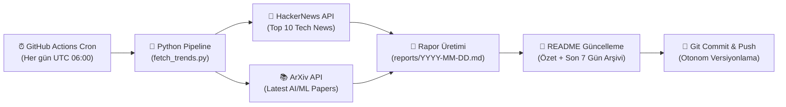

# 📡 AI & Tech Daily Radar

<p align="center">
  
  
  
  
  
</p>

> **AI & Tech Daily Radar**, her gün GitHub Actions üzerinde otonom olarak çalışan; HackerNews üzerindeki en sıcak teknoloji gelişmelerini ve ArXiv üzerindeki en yeni Yapay Zeka / Makine Öğrenimi (AI & ML) araştırma makalelerini toplayıp derleyen modern bir veri hattıdır (data pipeline).

---

<!-- LATEST_REPORT_START -->
### ⚡ Son Güncelleme: `2026-10-14`

> 📊 **Bugünün Özeti:** 10 HackerNews teknoloji trendi ve 5 ArXiv AI/ML akademik makalesi tarandı.  
> 📑 **Tam Rapor:** [Günün Raporunu Görüntüle (`reports/2026-10-14.md`)](reports/2026-10-14.md)

#### 🔥 HackerNews Öne Çıkanlar
| Başlık | Puan | Yorum | HN Linki |
|--------|:----:|:-----:|:--------:|
| [Gemini 4 Argon](https://deepmind.google/models/gemini/) | ⭐ 1331 | 💬 925 | [Tartışma](https://news.ycombinator.com/item?id=50073879) |
| [Redesigning source control at Anthropic](https://www.anthropic.com/engineering/redesigning-source-control) | ⭐ 788 | 💬 816 | [Tartışma](https://news.ycombinator.com/item?id=50073633) |
| [Ledger confirms spy chip implant behind wallet crypto thefts](https://www.bleepingcomputer.com/news/security/ledger-confirms-hardware-wallet-spy-implant-behind-crypto-thefts/) | ⭐ 720 | 💬 452 | [Tartışma](https://news.ycombinator.com/item?id=50054092) |
| [Show HN: Guitoro, a virtual guitar you strum with your keyboard](https://guitoro.com/) | ⭐ 450 | 💬 116 | [Tartışma](https://news.ycombinator.com/item?id=50077020) |
| [The United Kingdom generates less electricity per person than in the 1970s](https://ourworldindata.org/data-insights/electricity-generation-per-person-in-the-united-kingdom-has-fallen-by-a-third-from-its-early-2000s-peak) | ⭐ 329 | 💬 534 | [Tartışma](https://news.ycombinator.com/item?id=50072994) |

#### 🤖 ArXiv AI/ML Öne Çıkan Araştırmalar
- 📄 **[ChunkAct: Action Chunking for Agentic Robotics](http://arxiv.org/abs/2610.18874v1)**
  *Agentic robotics places a large language model (LLM) agent in the robot control loop, where it composes perception, motion, and vision-language-action (VLA) tools under the guidance of a memory and th...*

- 📄 **[Cepheid: Decoupling Scale from Structure for Cross-Family Motion Completion](http://arxiv.org/abs/2610.18871v1)**
  *Sparse-to-dense motion completion recovers dense mesh motion from sparse vertex displacements. Residual priors trained on one geometry family frequently fail to beat parameter-free harmonic extension...*

- 📄 **[What Matters in Quality-Aware VLA Pretraining: A Benchmark and Empirical Study](http://arxiv.org/abs/2610.18869v1)**
  *How should demonstration quality be used during vision-language-action (VLA) pretraining to improve performance after target-task fine-tuning? We compare weighting, filtering, and conditioning across...*

#### 🗄️ Son 7 Günün Rapor Arşivi
- [📅 2026-10-14 Raporu](reports/2026-10-14.md)
- [📅 2026-10-13 Raporu](reports/2026-10-13.md)
- [📅 2026-10-12 Raporu](reports/2026-10-12.md)
- [📅 2026-10-11 Raporu](reports/2026-10-11.md)
- [📅 2026-10-10 Raporu](reports/2026-10-10.md)
- [📅 2026-10-09 Raporu](reports/2026-10-09.md)
- [📅 2026-10-08 Raporu](reports/2026-10-08.md)
<!-- LATEST_REPORT_END -->

---

## 🏗️ Mimari ve Nasıl Çalışır?

Bu sistem, harici bir sunucu veya veritabanı ihtiyacı olmadan tamamen **serverless** ve **Git-as-a-Database** yaklaşımıyla çalışacak şekilde tasarlanmıştır:



### ⚙️ Çalışma Aşamaları (ETL)

1. **Extract (Çıkarma):**
   - **HackerNews Algolia API:** Günün en popüler 10 teknoloji trendini (başlık, puan, yorum sayısı, URL) çeker.
   - **ArXiv API:** Bilgisayar Bilimleri / Yapay Zeka (`cs.AI`) ve Makine Öğrenimi (`cs.LG`) kategorilerinde yayımlanan en güncel 5 akademik makaleyi (`ElementTree` XML ayrıştırıcı ile) çeker.

2. **Transform (Dönüştürme):**
   - Alınan ham veriler standart bir Markdown formatına dönüştürülür.
   - Makale özetleri optimize edilir, tablolar ve bağlantılar biçimlendirilir.
   - Son 7 günün arşiv linkleri otomatik tespit edilir.

3. **Load (Yükleme & Dağıtım):**
   - Günün tarihine özel `reports/YYYY-MM-DD.md` dosyası oluşturulur.
   - Ana dizindeki `README.md` dosyasındaki belirlenmiş işaretçiler arasına güncel özet ve arşiv tablosu işlenir.
   - Değişiklikler GitHub Actions botu tarafından depoya geri `commit` ve `push` edilir.

---

## 🚀 Yerel Kurulum ve Çalıştırma

Projeyi yerel makinenizde test etmek isterseniz:

```bash
# 1. Projeyi klonlayın
git clone https://github.com/themuhammedguler/ai-tech-radar.git
cd ai-tech-radar

# 2. Bağımlılıkları yükleyin
pip install -r requirements.txt

# 3. Veri hattını çalıştırın
python src/fetch_trends.py
```

Rapor oluşturulduktan sonra `reports/` dizinini ve `README.md` dosyasını inceleyebilirsiniz.

---

## 📜 Lisans

Bu proje [MIT](LICENSE) lisansı ile lisanslanmıştır.
