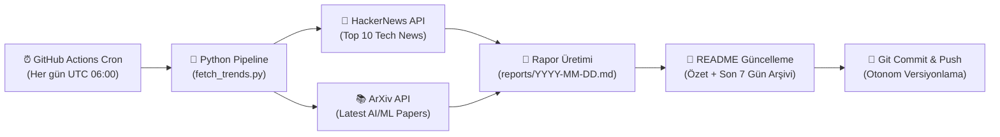

# 📡 AI & Tech Daily Radar

<p align="center">
  
  
  
  
  
</p>

> **AI & Tech Daily Radar**, her gün GitHub Actions üzerinde otonom olarak çalışan; HackerNews üzerindeki en sıcak teknoloji gelişmelerini ve ArXiv üzerindeki en yeni Yapay Zeka / Makine Öğrenimi (AI & ML) araştırma makalelerini toplayıp derleyen modern bir veri hattıdır (data pipeline).

---

<!-- LATEST_REPORT_START -->
### ⚡ Son Güncelleme: `2026-10-26`

> 📊 **Bugünün Özeti:** 10 HackerNews teknoloji trendi ve 5 ArXiv AI/ML akademik makalesi tarandı.  
> 📑 **Tam Rapor:** [Günün Raporunu Görüntüle (`reports/2026-10-26.md`)](reports/2026-10-26.md)

#### 🔥 HackerNews Öne Çıkanlar
| Başlık | Puan | Yorum | HN Linki |
|--------|:----:|:-----:|:--------:|
| [We should be more ambitious with the software we build](https://danluu.com/ambitious/) | ⭐ 819 | 💬 722 | [Tartışma](https://news.ycombinator.com/item?id=50225695) |
| [A 10-year-old CNN outperforms frontier LLMs for skin cancer diagnosis](https://lynchlab.net/llm-skin-cancer) | ⭐ 582 | 💬 247 | [Tartışma](https://news.ycombinator.com/item?id=50233779) |
| [Dolly Parton's Imagination Library](https://imaginationlibrary.com/) | ⭐ 572 | 💬 96 | [Tartışma](https://news.ycombinator.com/item?id=50234474) |
| [I refuse to accept a censored Internet. Join Me at FOSDEM 27](https://talkweb.eu/openweb/4558/) | ⭐ 498 | 💬 241 | [Tartışma](https://news.ycombinator.com/item?id=50233929) |
| [OpenAI and Anthropic cut their LLM prices by up to 80% within a few months. Why?](https://minimaxir.com/2026/10/cheap-llms/) | ⭐ 346 | 💬 335 | [Tartışma](https://news.ycombinator.com/item?id=50236102) |

#### 🤖 ArXiv AI/ML Öne Çıkan Araştırmalar


#### 🗄️ Son 7 Günün Rapor Arşivi
- [📅 2026-10-26 Raporu](reports/2026-10-26.md)
- [📅 2026-10-25 Raporu](reports/2026-10-25.md)
- [📅 2026-10-24 Raporu](reports/2026-10-24.md)
- [📅 2026-10-23 Raporu](reports/2026-10-23.md)
- [📅 2026-10-22 Raporu](reports/2026-10-22.md)
- [📅 2026-10-21 Raporu](reports/2026-10-21.md)
- [📅 2026-10-20 Raporu](reports/2026-10-20.md)
<!-- LATEST_REPORT_END -->

---

## 🏗️ Mimari ve Nasıl Çalışır?

Bu sistem, harici bir sunucu veya veritabanı ihtiyacı olmadan tamamen **serverless** ve **Git-as-a-Database** yaklaşımıyla çalışacak şekilde tasarlanmıştır:



### ⚙️ Çalışma Aşamaları (ETL)

1. **Extract (Çıkarma):**
   - **HackerNews Algolia API:** Günün en popüler 10 teknoloji trendini (başlık, puan, yorum sayısı, URL) çeker.
   - **ArXiv API:** Bilgisayar Bilimleri / Yapay Zeka (`cs.AI`) ve Makine Öğrenimi (`cs.LG`) kategorilerinde yayımlanan en güncel 5 akademik makaleyi (`ElementTree` XML ayrıştırıcı ile) çeker.

2. **Transform (Dönüştürme):**
   - Alınan ham veriler standart bir Markdown formatına dönüştürülür.
   - Makale özetleri optimize edilir, tablolar ve bağlantılar biçimlendirilir.
   - Son 7 günün arşiv linkleri otomatik tespit edilir.

3. **Load (Yükleme & Dağıtım):**
   - Günün tarihine özel `reports/YYYY-MM-DD.md` dosyası oluşturulur.
   - Ana dizindeki `README.md` dosyasındaki belirlenmiş işaretçiler arasına güncel özet ve arşiv tablosu işlenir.
   - Değişiklikler GitHub Actions botu tarafından depoya geri `commit` ve `push` edilir.

---

## 🚀 Yerel Kurulum ve Çalıştırma

Projeyi yerel makinenizde test etmek isterseniz:

```bash
# 1. Projeyi klonlayın
git clone https://github.com/themuhammedguler/ai-tech-radar.git
cd ai-tech-radar

# 2. Bağımlılıkları yükleyin
pip install -r requirements.txt

# 3. Veri hattını çalıştırın
python src/fetch_trends.py
```

Rapor oluşturulduktan sonra `reports/` dizinini ve `README.md` dosyasını inceleyebilirsiniz.

---

## 📜 Lisans

Bu proje [MIT](LICENSE) lisansı ile lisanslanmıştır.
